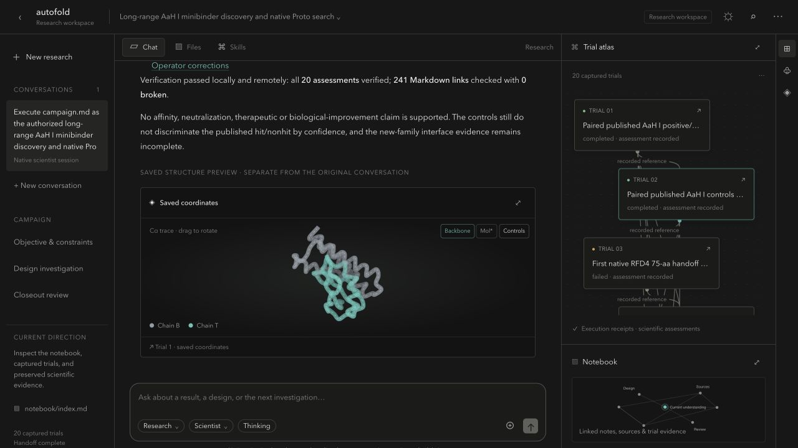
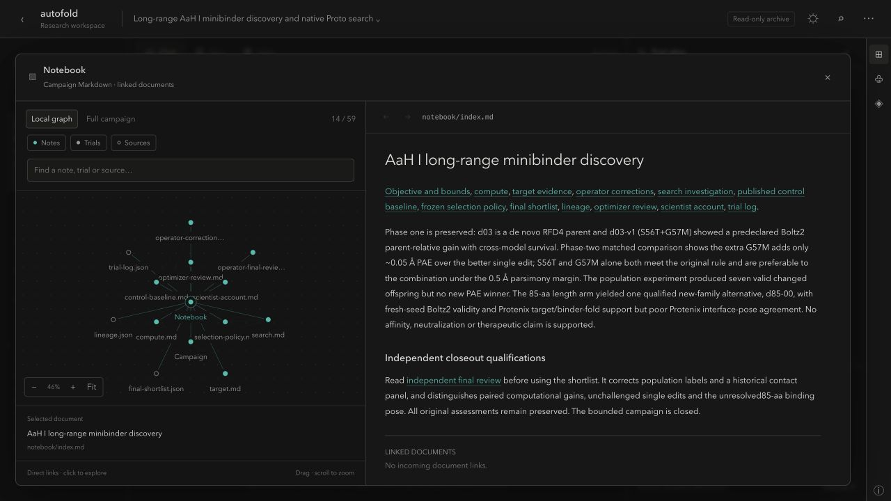
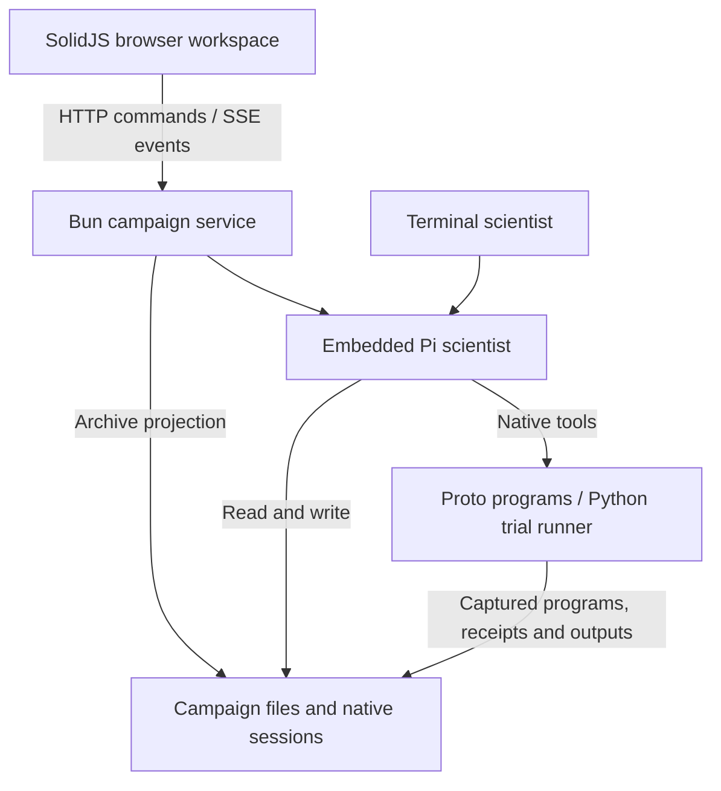

# Autofold

**An agentic protein-discovery platform with executable experiments and traceable evidence.**

Autofold gives an AI scientist the tools to investigate biological targets, write
and execute native Proto programs, evaluate protein candidates and maintain an
evidence-linked laboratory notebook. It connects the research process to a full
application: streaming scientist conversations, an interactive trial atlas,
molecular visualization and a navigable graph of the campaign's scientific record.

The engineering spans agent integration, scientific model adapters, experiment
capture and a reactive frontend. A research objective can become a sequence of
computational trials whose code, inputs, structures and assessments remain
inspectable after the conversation ends.

**Stack:** TypeScript · SolidJS · Bun · Python · Pi · Proto · Mol* · RDKit.js

[Run locally](#run-locally) · [Technical architecture](#technical-architecture) · [Development](#development-and-validation)



*A saved 20-trial campaign investigating minibinders against the scorpion toxin
AaH I. The structure viewer displays captured coordinates; the atlas opens each
trial's plan, code, assessment and outputs.*

## Engineering highlights

- **Integrated scientist runtime.** Connects Pi's native agent sessions to a
  browser application with streamed responses, tool status, cancellation,
  evidence uploads and session continuation. The terminal and browser use the
  same runtime integration and campaign records.
- **Multi-model scientific execution.** Integrates native Proto workflows for
  target-conditioned generation, sequence redesign and structural screening.
  Exercised model paths include RFD4-Proteina, BoltzGen, ProteinMPNN, Boltz-2 and
  Protenix v2; each uses separately provisioned environments and model assets.
- **Experiment provenance.** A Python runner captures source bundles, declared
  inputs, hashes, execution receipts and saved outputs. Initial assessments have
  separate hash receipts, preserving the distinction between a completed process
  and a scientific interpretation.
- **Interactive experiment analysis.** The trial atlas connects plans, captured
  code, sourced metrics and molecular artifacts. Mol* provides an interactive
  structure viewer with a simplified backbone mode and scientific controls;
  RDKit.js renders compound depictions.
- **Persistent research memory.** A Markdown notebook links findings, sources and
  trials. The interface derives a navigable graph directly from those records,
  with local neighborhoods, full-campaign exploration, search and navigation
  history. Campaign selection keeps each investigation's records together.

<details>
<summary>Explore the notebook view</summary>



The graph comes from saved document links and declared trial inputs. Selecting a
node opens its underlying record. A connection records a reference; the linked
text explains what that evidence supports and where it falls short.

</details>

## In practice: a 20-trial minibinder campaign

The screenshots show a saved investigation of minibinders against the scorpion
toxin AaH I. Its 20 captured trials can be inspected from the same workspace as the
scientist's conversation and linked notebook. Open a trial to examine its plan and
Proto source, rotate a saved structure, then follow the notebook to later
corrections and unresolved questions. Failed and interrupted executions remain
part of the record.

**Current scope:** a local research application with live scientist sessions and
saved-campaign browsing. The pictured campaign is not bundled with the repository.
Its computational results do not establish measured binding affinity,
neutralization or therapeutic activity.

## Technical architecture

The system separates agent execution, scientific computation and record
inspection. Pi manages the agent loop; Autofold integrates it with scientific
skills, native Proto programs, captured experiments and a campaign-scoped API.



### Runtime and interface

| Layer | Implementation and responsibility |
| --- | --- |
| Interface | SolidJS, TypeScript and Vite; campaign navigation, streaming chat, trial inspection and notebook graph. Mol* renders structures; RDKit.js handles compound depictions. |
| Local service | Bun HTTP endpoints for campaign discovery, artifact access and live commands; server-sent events stream scientist text, tool status and archive updates. |
| Agent runtime | Pi owns the agent loop, tools, providers, session history and compaction. Autofold adds scientific instructions, skills, notebook initialization and assessment protection. |
| Scientific execution | Native Proto programs run through a Python trial runner. Generators, constraints, optimizers and model integrations depend on the selected environment. |
| Research records | Markdown, JSON, captured source and scientific artifacts on disk. The UI projects those records into the atlas and notebook graph. |

The live service creates a Pi runtime for a campaign when a scientist session is
opened. The browser reads native session history through a conversation projection;
it does not maintain a second transcript database. Archive browsing can operate
without creating a scientist.

### Scientific runtime adapters

Scientific model execution uses operator-provisioned environments and pinned
runtime profiles. The trial runner captures the selected profile and runtime
source with the experiment. Profile fingerprints detect implementation drift
within a campaign and participate in model-cache identity.

The qualified runtime routes preserve model-specific configuration and execution
identity. Unsupported requests fail explicitly; execution errors do not silently
change the backend or reduce the scientific protocol. The
[model menu](backend/engine/skills/proto-discovery/references/models.md) documents
generation, redesign and prediction routes; the
[runtime guide](backend/engine/runtime/OPERATIONS.md) describes provisioning and
qualification boundaries.

### Experiment capture and assessment

A trial gets a permanent address before its plan is written. Before execution,
the runner captures the program bundle and declared inputs, records their hashes,
and saves the command and environment metadata. After execution it records process
state, logs and the files the program saved, including partial outputs on failure.

```text
output/trials/t-<id>/
  plan.md           Prospective question and experiment plan
  trial.json        Launch specification and captured input/program hashes
  program/          Captured source bundle
  inputs/           Declared inputs copied into the trial
  output/           Saved results and artifacts
  execution.json    Execution receipt and output inventory
  assessment.md     Initial interpretation after inspecting the results
  assessment.json   Assessment hash and timestamp receipt
```

Assessment creation is a separate step from execution. Autofold protects initial
assessments against accidental edits and checks their receipts; later corrections
belong in linked notebook records. These checks are not a security sandbox or a
guarantee of scientific validity. Environment capture is not a complete dependency
or model-weight lock. See [captured trials](docs/engine.md#captured-trials) for the
exact guarantees and limitations.

### Notebook and artifact provenance

Campaigns contain `campaign.md`, `notebook/`, `sources/`, `programs/`, `inputs/`,
`output/` and native sessions under `.autofold/`. Graph nodes and edges are derived
from relative Markdown links and declared trial inputs, without a separate graph
database. The notebook can evolve while preserving references to earlier trials.

Optional presentation metadata references captured JSON metrics using file paths
and JSON pointers. Values are read from those files; missing sources remain
unavailable. Saved structure previews use captured coordinates. Model confidence,
structural agreement and pose-conditioned estimates remain distinct from measured
biological activity.

The service binds to loopback. Archive file access checks campaign boundaries,
including resolved symlinks, and excludes private files. Read-only mode disables
live commands. Live mode gives the scientist local file and shell tools; it is
intended for an operator-controlled research environment.

## Run locally

Use Node.js **22.19+**, npm and Bun (CI pins **1.3.14**). Trial capture and
backend tests also require Python **3.11+** on macOS or Linux.

From the repository root:

```sh
npm ci --ignore-scripts
npm run build
npm start
```

Open [127.0.0.1:4450](http://127.0.0.1:4450). A fresh checkout creates a default
workspace; use **new campaign** to record your own objective. Browsing records and
creating a campaign do not start inference.

### Configure the scientist

Chat uses the providers configured in Pi. Open the terminal scientist in a
separate campaign directory:

```sh
mkdir -p ../autofold-campaigns/example
npm run agent -- --workspace ../autofold-campaigns/example
```

Inside that terminal UI, use `/login` to configure provider credentials and
`/model` to select a model. Pi's provider environment variables also work. The
browser uses the same provider configuration; select a configured model before
sending a message. The application server runs locally; model calls use the
selected provider.

Resume the terminal campaign with:

```sh
npm run agent -- --workspace ../autofold-campaigns/example --continue
```

### Run scientific programs

Protein-model execution needs a separate Python environment with Proto, the
selected integrations, model weights and suitable compute. These are not installed
by npm. The [engine guide](docs/engine.md#proto) covers native programs, and the
[runtime operations guide](backend/engine/runtime/OPERATIONS.md) covers model
environments and compatibility patches. The CPU-only
[Proto example](examples/hello_proto.py) is a starting point once Proto is installed.

### Open existing research without live tools

With the application built, serve an existing campaign in read-only mode:

```sh
npm run archive -- --workspace /path/to/campaign --port 4450 \
  --web-root frontend/workspace/dist
```

Use this instead of `npm start` on the same port. Add
`--archives-dir /path/to/archive-parent` to discover campaigns stored as
`<run>/campaign/campaign.md`. This also lets the browser discover terminal-created
workspaces when arranged in that layout. Add `--live` to enable scientist commands
for those campaigns. See [workspace setup](docs/workspace.md) for details.

## Development and validation

```text
backend/engine/       Scientist integration, API, skills, runtime adapters and trial runner
frontend/workspace/  Campaign interface, atlas, notebook and scientific viewers
frontend/ui/         Shared themes, styles and sanitization
examples/            Reusable Proto and presentation examples
docs/                Architecture, setup and provenance
```

```sh
npm run typecheck
npm test
npm run build
```

The default suite exercises engine behavior, trial capture, research fixtures,
notebook links and frontend data/sanitization logic without model calls. A research
fixture binds a temporary loopback HTTP server. GitHub Actions is configured to run
these checks on pushes to `main` and pull requests. Model-backed validation needs
separately configured environments; see [validation](docs/engine.md#validation).

Keep campaign data outside the product checkout where practical. Local campaign
state, session histories, model environments and generated outputs are excluded
from product source; they are not included in a fresh clone.

## Documentation and credits

- [Browser workspace and campaign setup](docs/workspace.md)
- [Engine, notebooks and scientific workflow](docs/engine.md)
- [Scientific model menu](backend/engine/skills/proto-discovery/references/models.md)
- [Runtime environments and patches](backend/engine/runtime/OPERATIONS.md)
- [Source and historical-code boundary](docs/cleanup-boundary.md)
- [OpenScience provenance](docs/upstream-provenance.md)

Autofold builds on Pi for agent execution and Proto for scientific programs.
The interface adapts OpenScience's visual design and scientific viewers.
Autofold's engine integration, runtime adapters, trial-capture workflow, campaign
API, trial atlas and linked-notebook interface connect these foundations into the
research application described above.

Original Autofold code is provided under the [MIT license](LICENSE).
OpenScience-derived portions retain their Apache 2.0 attribution and license
requirements. Preserve [NOTICE.openscience](NOTICE.openscience) and the applicable
notices in [LICENSES](LICENSES) when redistributing derived work.
