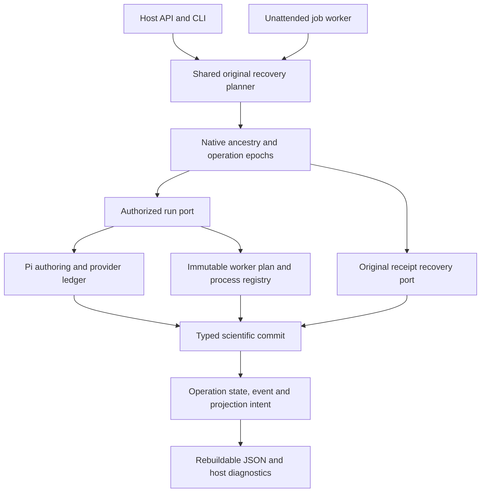

# Operation coordinator implementation — October 10, 2026

The host now separates permission to start work from permission to collect original receipts. Native jobs remain the liveness and ancestry authority. Canonical operation records add immutable identity/grants, atomic owner epochs and revisions, separate effect/accounting/outcome/settlement axes, append-only events and a projection outbox. This replaces mutable auxiliary JSON as an operation authority without rewriting existing scientific records.

## Boundaries

`backend/science-core/src/research/operations.ts` and `operation-service.ts` define the reducer boundary. State, events and outbox intent commit in the same project SQLite transaction. Managed operations validate both the captured native job epoch and the operation epoch; standalone auxiliary operations validate their own epoch. Scientific literature/review/skill/trial commits validate the operation handle inside their native transaction. A stale wrapper cannot bypass this with a successful earlier filesystem or session check.

`backend/engine/src/jobs/operation.ts` defines `OperationSpec.inspect/recover/run`, typed recovery outcomes and the ancestry planner. `RecoveryContext` supplies original checkpoint reads and a settlement-only operation port. It exposes no session creation, model invocation or scientific first-dispatch method. The generic legacy handler registration remains a compatibility adapter; production literature, independent review, refinement, shadow replay and campaign registration supply explicit recovery methods. Native scientist receipt recovery retains its existing bounded lane and data-only transcript closeout.

Auxiliary accepted proposals and captured context live in canonical operation state. JSON is written after the canonical transaction and acknowledged through the outbox. Publication failure leaves durable pending derivative work. Existing JSON-only operations remain readable for original receipt verification; ordinary continuation requires explicit migration rather than silent adoption as a second writable authority.

## Recovery and cancellation

Both manual settlement and unattended recovery use the same original ancestry plan. Queued work with no admission returns `queued_not_admitted`; recovery does not turn it into an ordinary run. The plan reports selected/root IDs, ordered original jobs and typed blockers.

Each auxiliary recovery method proves its original commit: literature actor/submission hash and cycle dependencies; review operation/input hash and frozen audit; refinement parent/content/source/origin identity; replay original benchmark, independent arms, contract and verified trial/run receipts. Accounting uses exact original session/model bindings and baselines. A complete scientific commit can rebuild its final result without repeating authoring or compute. Missing proposals, sessions, usage or receipts remain unresolved.

Campaign recovery separately reduces saved observations, proposals, completed steps and terminal original children. It charges each child and already-admitted replay once, preserves residual grant limits, and does not create a missing replay arm or another ordinary trajectory. Incomplete proposal effects and unattributed children block closeout.

Cancellation atomically revokes canonical run ownership. A separate settlement lease can observe verified original effects and accounting while the native job stays cancelled. It cannot prepare a new effect or regain an expired grant. A newly managed cancelled identity cannot be silently reset through retry; a new requested authorization needs a new identity.

## Process lifetime and implementation identity

Local and remote execution use the same durable supervision protocol. The launch controller, watchdog and original runner are separate processes. The runner and watchdog enforce the deadline fixed in the exclusive original launch intent, including the earliest captured host grant deadline. Killing one controller does not transfer deadline authority to a model or reset the timeout.

Process identity binds the kernel boot and process birth as well as PID. Adoption observes or stops the exact original process; it never spawns another scientific worker. A permanent launch fence retains ambiguity between intent and a durable process identity. Absence alone cannot create a successful receipt.

New execution requests snapshot the worker/evaluator implementation closure. Recovery verifies and selects those original bytes instead of requiring the current installed evaluator. The process plan hash also binds argv/runtime, allowed environment overrides, timeout and original authorization deadline. These changes are local source changes; they do not deploy or modify a remote workstation.

## Provider accounting

Provider dispatch intent still precedes a model call, and valid usage settlement precedes tools. `PiRuntime.reconcileModelUsage` accepts only a host verifier that attributes a completed upstream receipt to the exact persisted session/request/model/start identity. It stores receipt identity/hash and measured cost in the session journal transaction. Repeated identical evidence does not charge twice; conflicting evidence and reuse across requests/sessions are rejected. It never initializes a missing session, repairs a tool return, changes the original run outcome or calls a model. No online billing lookup is installed: without attributable upstream evidence, usage remains unknown.

## Host commands

- `GET /research/jobs/:id/recovery-plan` / `job recovery-plan JOB_ID`: inspect original ancestry without effects.
- `POST /research/jobs/:id/settle` / `job settle JOB_ID`: original receipt settlement with plan, selected job and typed outcomes.
- Existing `reconcile` responses remain compatible and return the selected job.
- `GET /research/operations` / `operations`: expose independent canonical axes and outbox status.
- `POST /research/operations/:id/rebuild-projection` / `operation rebuild-projection OP_ID`: rebuild auxiliary JSON from canonical state without repeating scientific work.

The campaign `submit_move` schema is generated from the same discriminated input schema used by host validation; provider payload tests verify nested required fields and bounds.

## Remaining limits

Native job storage is not replaced; native settlement markers follow job transitions and separately expose unsettled effects/accounting. Generic operation phase/state are still controller-validated rather than distinct typed reducers for every handler. Receipt semantics come from the trusted operation-specific verifiers, not from the generic CAS schema alone. Whole-project validation/ownership reads remain a scaling cost. An isolated local SQLite fixture with 100/1,000/5,000 jobs and one 1KB checkpoint each measured median ownership checks of 1.90/7.54/32.46ms and observed p95 of 3.76/8.79/41.73ms (12 samples per size). This is a small local measurement, not a production concurrency benchmark. Indexed lease headers and load testing remain future work.

An ambiguous process spawn before its original birth identity is durable remains unresolved and cannot be relaunched. Simultaneous loss of all independent supervisors needs original identity adoption; machine loss/reboot cannot produce an absent exit receipt. Provider evidence cannot be reconstructed from an invoice estimate. Pending historical JSON-only operations require explicit migration before new work. The complete implementation is not a universal fault-tolerance claim.

Verification and before/after preservation are recorded in [the implementation acceptance report](../acceptance/operation-coordinator-implementation-2026-10-10.md). Earlier acceptance decisions and closed grants remain separate.

## Live validation follow-up

The unchanged coordinator/worker source completed one fresh GPU execution and canonical/physical settlement on October 10. Terminal original-receipt reopening added no work. The current worker was staged under that new run identity; installed remote model environments were unchanged. No live fault was injected. See [the measured result and boundaries](../acceptance/coordinator-gpu-trial-2026-10-10.md).
