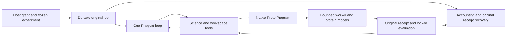

# Pi science layer simplification — October 11, 2026

Autofold supplies scientific capabilities and durable execution authority around Pi. Pi owns the model/tool loop, error-driven editing and repair, conversation state and automatic compaction. The integration had added a second discovery loop which restarted short Pi runs and counted only completed evaluations as progress. That loop could stop a scientist after three 16-response batches even while it was diagnosing and repairing a program within its remaining grant.

## Responsibility boundary

The discovery host now invokes Pi once for each admitted discovery job. Read/edit/write/validate/evaluate/review actions continue within that invocation. Natural agent completion returns `scientist_completed`; an explicit runtime request/tool limit returns `runtime_limit_reached`. A campaign surfaces either as a deferred boundary with its unused allowance intact. It does not automatically manufacture another prompt or scientist job. Explicit `stop_discovery`, experiment eligibility, evaluation admission, cancellation, original deadlines, ownership and receipt settlement retain their existing roles.

There is no evaluation-only no-progress counter and no replacement progress heuristic. Scientific discovery no longer has hidden 16-request/32-tool chunks. Caller-supplied runtime request/tool limits remain enforced in a single invocation. Cost and finite wall-time grants still bound every job. `maximumDurationMs` names the entire discovery job ceiling; any explicit runtime duration can only shorten it, and the inherited parent deadline remains authoritative. Without an explicit duration, fresh jobs derive a finite ceiling from the frozen per-trial wall allowance plus five minutes of model/authoring time per admitted evaluation. Historical payloads and checkpoints remain readable. New admissions reject retired `maximumAuthoringAttempts`/`maximumNoProgressAttempts` arguments instead of silently ignoring caller-supplied policies; callers should supply explicit request/tool/time/cost limits. Legacy `authoringTimeMs` remains a deprecated additional job-time input.

## Science capabilities and actionable feedback

BoltzGen and PXDesign remain registered GPU generators with host executable/cache readiness and exact-spec preflight. Their native adapters invoke their own CLIs; they do not dispatch the nonexistent `boltzgen-design`/`pxdesign-design` Proto tool keys. Generator metadata therefore declares no registered Proto tool calls for these direct CLIs. Native sampling/proposal counts still record their effects, and their trusted CLI runner receives the remaining native-search wall allowance. The timeout is restored after each sampling call, including failure. Actual Proto tool keys retain strict registry admission, allowlists and tool-request accounting. External generator sampling is not relabeled as a registered tool call or physical model-inference count.

Citation validation stays scoped and strict. Typed evidence-reference failures now return the allowed persisted IDs, scope and `EVIDENCE.json` location with a concrete repair instruction. Hashes remain provenance rather than fabricated citation identities. The authoring API explains both this distinction and external-generator versus registered-tool semantics.

## Verification

Offline checks passed 572 backend/client tests (1 optional skip), 103 worker tests, backend and SDK typechecks. The complete durable-job suite separately passed 38 checks. Final immutable source identities and exact verification are recorded in `.autofold/pi-science-layer-simplification-20261011/operator/verification.json`. Tests cover a real Pi SDK loop which receives an invalid native draft, inspects its rejection, continues beyond 48 injected responses, repairs and validates the program, then completes exactly one original CPU worker evaluation. The stream is scripted offline; this is not evidence that a paid model independently chose those repairs. Additional checks cover natural completion without host re-prompting, explicit request limits, soft cost overshoot accounting, scoped citation feedback, actual installed Proto compilation with a portable external-parser shim, CLI timeout restoration, early refinement/replay protection and original receipt recovery.

No paid model calls, remote GPU trials or replacement scientific work are authorized or launched by this implementation. All sixteen prior workspaces are compared through exact logical SQLite/file snapshots. Older acceptance failures and closed grants remain preserved. The OpenRouter actual-cost versus SDK static-estimate mismatch is still an accounting gap. Autonomous learned-model repair, fresh external-generator GPU execution and long-range acceptance on this source remain unverified.
