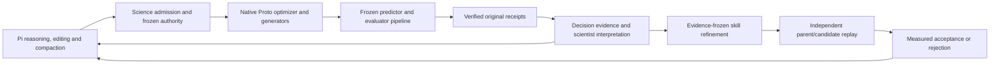

# Science layer interoperability — October 12, 2026

The science layer interoperates with the native execution and Pi subsystems, but its learning handoffs needed repair. Six valid live native peptide trials, two live Pi capacity recoveries, verified native authoring, settled billing and original receipt-only closeout establish execution integration. They do not establish scientific acceleration or a repeatable method improvement. The completed campaign still has six trials and no actual refinement or protected replay.

## Ownership and verified interfaces

Science-core owns scientific records, comparisons, evidence scope and frozen contracts; it imports neither Pi nor engine execution and does not own subprocess construction. Engine supplies runtime integration, contained native admission, job/effect identity and original receipt verification. Pi owns tool sequencing, file editing, repair and compaction. Proto retains its native optimizer, generator/model interfaces, constraints/objectives and internal search. The scientist chooses programs and scientific interventions. Graph, literature and research questions are advisory and run separately; unavailable enrichment does not gate independent discovery.

The host still rejects incompatible frozen target/evaluator/seeds, over-budget work, invented evidence and unknown prior effects. These are scientific authority boundaries. Current offline tests exercise real native compilation and repairs before dispatch, rather than replacing Proto with a second implementation. Paired activation remains based on verified results, independent programs/sessions/candidate sets and equal reserved budgets; no operator forces a positive scientific result.

## Repairs made in this audit

Scientist reviews were durably saved to REVIEWS.json but absent from the boundary and refinement context. The scientist, campaign boundary and refiner now receive the latest scoped review cards. Revision replacement is explicit; other campaign/experiment/run reviews are excluded. Cards preserve prediction assessment, interpretation, next decision, limitations, evidence references and scientist_interpretation authority. Four cards and bounded prose prevent wholesale copying of numerical tables; full reviews remain available on demand. On the preserved six-run campaign, all three real reviews project from 46,219 serialized bytes to 6,558 bytes. This is a projection comparison, not measured live total-context or latency reduction.

Refinement now freezes verified predictor observations, evidence completeness, host procedural signals and the relevant scientist reviews for the exact supplied runs/trials. A later review revision cannot silently rewrite an admitted operation. Interpretations remain separate from worker measurements, and no historical run/session is initialized or imported by the audit.

Native replay uses its existing submit_shadow_program tool to record guidanceApplication: a short exact skill-content quote, the program decision it informs and a falsifying observation. The accepted record is bound to the exact arm's skill version/content hash and immutable submitted program hash. The operation returns per-arm traces and original-effect recovery validates existing traces without inference. This is a prospective scientist declaration, not proof that guidance caused a gain. A malformed quote is repairable through Pi before native inspection or dispatch. No additional approval, review tool or model-output cap was introduced; legacy saved arms without traces remain historical.

Accepted skill versions are explicit in Pi's progressive resource descriptions and immutable paths. Continued scientist context supplies the accepted current version, excludes the superseded parent from active resources and instructs the agent to read changed guidance before applying it. Old instructions in conversation history remain historical evidence.

Stops now record host versus scientist authority, typed reason, remaining aggregate/ordinary/replay slots, whether the boundary scientist assessed refinement and why protected slots were unused. Runtime completion, boundary limits and resource/attention boundaries also receive an explanation. An empty feedback array is not a scientific judgment. No testable guidance change remains a valid evidence-supported stop; twelve trials are a maximum, not a forced count.

## Verification and remaining proof

Network-disabled verification passed 150 tests across 12 files, plus a final accepted-guide continuation check (a subset), and strict engine/science-core typechecks. Tests include the actual 12-evaluation CPU fixture, six traced independent replay arms, guide activation/rejection/nonregression, accepted-guide context, native nested-plan/quote repair, revision/scope fidelity, frozen refinement reopen, cancelled/unknown-effect recovery and live-shaped Pi capacity admission/compaction. Scripted model streams and CPU fixture outcomes prove integration, not GPU science or general skill improvement.

All 27 older workspaces and the completed campaign's 1,565 files are unchanged. The preceding refinement investigation audit is also unchanged. Its source hashes describe its historical implementation and are not rewritten to pretend these later edits existed at closeout. The monitor remains paused, all old grants remain closed, and no paid campaign, provider call or GPU dispatch was launched.

The next empirical step is a fresh bounded live learning-loop test: scientific discovery, a concrete falsifiable guidance change, three independent equal-budget parent/candidate pairs, a justified acceptance/rejection decision and continued ordinary discovery under the accepted guide or retained parent. Compare valid-only objective utility and actual native search/runtime observations; equal budget reservations alone do not prove runtime savings. Preserve upstream generation seed-control limitations and distinguish computational proxy improvement from peptide binding or biological validation. A fixed scoring seed and small samples cannot establish a general workflow advantage.

Evidence: `.autofold/science-interop-investigation-20261012/verification.json`. Logs: `/private/tmp/autofold-science-interop-offline-verified-20261012.log`, `/private/tmp/autofold-science-interop-guide-continuation-20261012.log`, `/private/tmp/autofold-science-interop-engine-types-verified-20261012.log`, `/private/tmp/autofold-science-interop-core-types-20261012.log`. [Live protocol](../acceptance/science-interop-live-verification-plan-2026-10-12.md).
