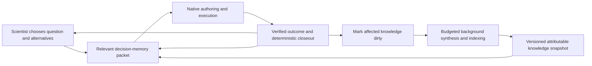

# Scientific memory design — October 12, 2026

Status: proposed architecture for review. No memory backend or production behavior is changed by this document. The running science-interoperability campaign remains pinned to its launch source and protocol. Backend selection follows the memory contract, not the other way around.

## Purpose

Memory should help the scientist choose a better next experiment from accumulated experience, without making the scientist repeatedly reconstruct that experience or wait for an auxiliary service. It should answer: what have we tried under comparable conditions, what actually happened, what interpretation is still defensible, what remains uncertain, and which observation would distinguish the remaining explanations?

The desired outcome is better justified discovery decisions per unit of time and compute. Storage volume, number of graph links, retrieval similarity, summary fluency and selected best scores are intermediate properties, not success criteria.

Three separations govern the design:

- A recorded result differs from its interpretation. Computational predictions differ from biological measurements.
- A promising candidate differs from a reliable method. One good draw cannot establish a reusable procedure.
- Remembering relevant guidance differs from validating that guidance. Independent replay still decides activation.

## Responsibilities

| Layer | Responsibility | Existing foundation | Proposed improvement |
| --- | --- | --- | --- |
| Evidence | Preserve original observations, programs, conditions, identities and unknowns | Research store, verified receipts, trajectory journal, decision evidence | Reuse exact identities and deterministic comparison groups in all exports |
| Knowledge | Maintain what the evidence means, including competing explanations and contradictions | Claims, hypotheses, scientist reviews, knowledge cycles, linked wiki pages | Versioned synthesis organized by scientific question and applicability |
| Retrieval | Select useful experience for this decision | Knowledge/graph reads, planning views and bounded context | Question- and intervention-aware ranking plus mandatory relevant exceptions |
| Delivery | Put selected evidence and meaning into the scientist's existing workflow | read_context, evaluation closeout, native result tools | A single bounded decision-memory packet with provenance and freshness |

The provenance graph remains a deterministic projection of recorded relationships. Semantic associations may suggest where to look, but they cannot silently become recorded scientific relationships. A memory backend is a replaceable index and synthesis assistant over explicitly exported evidence, not a second canonical research ledger.

## What the scientist should experience

At an experiment boundary, the scientist receives a compact brief:

1. Current incumbent candidate and the limits of that evidence.
2. Relevant comparable prior attempts, including failed and invalid outcomes.
3. Replication evidence and measured variation for the proposed configuration.
4. Current explanations, contradictory observations and unanswered questions.
5. Current active guidance, its version and the scope in which it was tested.
6. What changed since the scientist last received memory.

For example, a proposed length change should surface prior length comparisons and the replication result that challenges their interpretation. The brief should distinguish "this candidate had the lowest recorded loss" from "this generation setting reliably improves loss." It may suggest replication as an informative alternative; the scientist chooses the experiment and declares what outcome would change its next decision.

Memory does not require a new approval, a wiki-reading ritual, or a separate model call before every evaluation. Relevant context arrives through the existing scientist tools. Exact sources remain available for expansion. A deliberately justified replicate remains valid even when the configuration was tried before.

## Two coupled loops

The upper loop is the existing discovery loop. Verified facts become visible immediately after deterministic closeout. The lower loop prepares useful knowledge for later decisions. Discovery uses the latest completed applicable synthesis plus any newer verified evidence delta; it does not wait for synthesis to catch up.

Proactive means reacting to meaningful changes and preparing context ahead of the next decision. It does not mean giving a memory agent independent authority to launch experiments, conduct external research, change scientific contracts or continuously spend money.

## Update triggers and scheduling

| Trigger | Immediate deterministic work | Optional semantic work |
| --- | --- | --- |
| Original run settled | Preserve receipt-linked outcome, failure/invalid status, candidate identity and conditions | Update the affected scientific question and method explanation |
| Scientist interpretation revised | Preserve revision and exact source bindings | Reconcile changed interpretation with connected knowledge |
| A repeat/replicate arrives | Update descriptive comparison groups and independence facts | Reconsider whether a prior conclusion survives replication |
| New opposing evidence | Expose both source records and their applicability | Mark the associated synthesis contested or needing review |
| Guide accepted/rejected | Publish the exact current guide and measured replay decision | Update procedural lesson and its tested scope |
| New declared decision | Construct a bounded brief from current evidence | Prefetch relevant completed synthesis; no automatic new experiment |

Use existing durable operations/outbox patterns for a future memory compiler, with idempotency keyed by scope, source revision and compiler configuration. Mark dirty at the original commit boundary, coalesce overlapping updates, and compile against an immutable source manifest. Do not make a fresh synthesis job for every file read, chat turn or token.

The compiler has explicit credentials/data scope, a finite independent allowance or a declared share of a future campaign grant, request accounting, cancellation and deadline. It runs at lower priority than scientific execution. Unknown dispatched billing blocks further compiler inference; queueing cannot bypass that fence. Deterministic indexing can proceed without an LLM. The current live grant does not authorize installing or launching this new compiler.

## Attributable knowledge objects

Reuse and extend the existing claim, hypothesis, review and knowledge-cycle records rather than starting a competing wiki database. A maintained interpretation needs:

- Scientific question/concept, statement and kind: interpretation, hypothesis or procedural proposal.
- Exact supporting and opposing source IDs/hashes; original run identities deduplicated independently of repeated summaries.
- Applicability: target, modality, contract/evaluator, configuration family, predictor/generator versions, seed-control facts and relevant conditions.
- Evidence scope: single draw, descriptive replication, controlled comparison or tested guidance. Missing information stays explicit.
- Remaining explanations, limitations, falsifying observation and implications for possible next decisions.
- Revision lineage, source manifest, compiler/model/prompt identity and freshness status.

A deterministic validator checks source existence, hashes, scope, cutoff and revision lineage. Those checks establish attribution and integrity, not the semantic correctness of a conclusion. Interpretation quality requires evidence review and evaluation. A confidence score, number of retrieved snippets or backend support count cannot substitute for independent scientific evidence.

Maintain separate states for current, contested, superseded and unresolved knowledge. Preserve previous versions and negative outcomes. Time alone does not invalidate a durable failure lesson; a changed API, contract or later contradictory result can change its applicability. Deleting a derived index must not delete original evidence.

## Decision-memory contract

The host accepts a decision query containing the existing scientific question, candidate alternatives/interventions, intent, current guide references, host-bound scope and an immutable evidence snapshot. Derive it from the native decision plan and current experiment; a retrieval provider cannot expand the scope.

The response is one DecisionMemoryPacket with:

- Snapshot/hash, evidence cutoff, canonical source revision and semantic compilation revision.
- Relevant receipt-backed results and deterministic comparison/replication summaries.
- Attributable interpretations, opposing evidence, failed approaches and open questions.
- Active guide references and newly changed evidence.
- Exact source references for on-demand expansion.
- Coverage, omitted categories, unresolved references, freshness and fallback status.
- Retrieval query, backend/index/configuration identity, selected order, packet bytes, observed latency and any metered inference identities.

The packet supplements current verified evidence and allowances; it does not replace them. Host validation resolves every returned reference against the original store before publication. Never accept arbitrary backend prose as a verified observation. If a source changed, reject that item and expose the gap.

Selection begins with scope and comparability. Rank eligible records by relevance to the proposed scientific question/configuration, then preserve opposing evidence and the most relevant failure/replication facts. Recency is useful for changed knowledge, not the sole measure of importance. An old disconfirming result can outrank a recent successful candidate. Noncomparable but potentially instructive material must be labeled as analogy and kept separate from quantitative comparisons.

Use an adjustable input-context budget admitted by Pi's full prepared-payload capacity check; this is not an arbitrary completion/output cap. Include compact structured values and exact pointers rather than full source modules or entire histories. A memory query should normally read a prepared local snapshot, with lexical/metadata fallback if semantic retrieval is unavailable. Measure the latency envelope before choosing an operational timeout; do not invent a speed guarantee.

## Integration with the discovery loop

- At initial read_context: provide the current applicable question/method brief and verified evidence delta.
- When alternatives or a captured decision plan change: refresh relevance from the prepared snapshot through existing context/validation feedback. Reuse prior retrieval when both query and snapshot identities match.
- At evaluate_trial return: preserve the existing mandatory verified closeout, then publish changed facts immediately and mark affected knowledge dirty. Semantic compilation is not an iteration barrier.
- At campaign boundaries: provide the same attributable evidence and synthesis to the boundary scientist/refiner, avoiding divergent definitions of a result.
- At refinement/replay: freeze the exact input snapshot and selected interpretation/review revisions. Candidate generation and acceptance retain their existing independent evidence rules.
- At continuation: deliver accepted current guidance or retained parent guidance, its version change, and relevant new result interpretation. Do not silently carry superseded guidance forward as active.

Record which memory items informed the prospective question, alternative and program decision. This trace measures exposure and declared use; it is not proof that memory caused scientific improvement. Treat retrieved text as untrusted data, with no credentials, dispatch commands or authority-changing instructions.

## Failure behavior and replay isolation

Semantic-service timeout, indexing failure or unavailable synthesis produces an explicit advisory gap and a deterministic packet. Canonical facts remain current. Required source-integrity failures retain their existing fences; the fallback must not fabricate evidence or bypass unknown original operation effects.

A paired comparison freezes common knowledge, source manifest, guide versions and retrieval configuration before either arm begins. Both arms receive the same eligible common evidence and their assigned guide. Sibling outputs, future reviews and background consolidations cannot enter the pair. Separate immutable indexes or equivalent verified snapshot isolation are required; a date filter over a mutable shared bank is insufficient.

Record bank/snapshot identity, queries and returned source hashes/order. If memory changes between arms, the comparison cannot be presented as an isolated guide-only test. A future experiment testing memory itself should hold scientific/Pi budgets equal and identify memory as the intervention. That is separate from a guide-improvement experiment.

## Implementation sequence

1. Define the packet, query, source manifest and attributable knowledge lifecycle in science-core; reuse current receipts, DecisionEvidence and ScientistReview semantics.
2. Implement one engine-owned packet builder with metadata/lexical selection and deterministic comparisons. Connect it to the existing scientist/boundary/refiner views. Establish a useful baseline before selecting a memory backend.
3. Add incremental budgeted synthesis using native Pi and existing durable auxiliary operation/accounting patterns. Compile question-level knowledge; preserve old versions and source cutoffs.
4. Add one replaceable semantic retrieval adapter over approved immutable exports. Avoid multiple independently maintained stores of scientific truth or a second uncontrolled agent loop.
5. Evaluate against the baseline, then use a fresh pinned live protocol if offline results justify it. No changes enter the running comparison.

Memory owns evidence selection and attributable knowledge continuity. Pi owns reasoning, authoring, compaction and inference recovery. Proto owns native generation/search. The host owns scientific authority, execution identity, grants and receipt verification.

## Acceptance

Use a hash-pinned synthetic science corpus containing failed and invalid outcomes, unreplicated best draws, comparable and noncomparable configurations, old opposing evidence, revised interpretations, superseded guides and explicit unknowns. Gold questions name exact eligible source IDs, independence scope and conclusion limits.

Require zero fabricated references, cross-scope/future/sibling leakage or authority upgrades; preserve invalid/null/unknown semantics and independent-run counts. Measure relevant-evidence recall at equal packet size, opposing-evidence retrieval, missed repeated failures, stale conclusions, retrieval/compilation cost, latency and fallback behavior. Evaluate semantic entailment as well as citation validity: a real citation can still accompany a false interpretation.

Then assess matched decision tasks: does memory lead to a justified replication/control, prevent an already-resolved diagnostic from being repeated, preserve a useful failed approach, or choose an intervention supported by the available evidence? Passing retrieval tests does not establish peptide discovery acceleration. Any live claim requires independent valid trials, measured resources and honest limits; biological claims require experimental validation.

## Code anchors

- `backend/science-core/src/research/scientist-memory.ts`: append-only original trajectory events.
- `backend/science-core/src/research/trajectory-closeout.ts`: immediate idempotent trusted facts, optional interpretation.
- `backend/science-core/src/research/decision-evidence.ts`: receipt-backed comparisons, repeated candidates, replication summaries and original decision plans.
- `backend/science-core/src/research/scientist-review.ts`: versioned interpretation with evidence references.
- `backend/science-core/src/research/knowledge.ts` and `knowledge-service.ts`: linked knowledge bundles, source-grounded records and review lifecycle.
- `backend/engine/src/scientist/context.ts`: current bounded decision-context delivery.
- `backend/engine/src/knowledge/graph.ts`: deterministic project relationship projection.
- `backend/engine/src/knowledge-review-controller/index.ts`: native Pi reconciliation over frozen scoped sources.
- `backend/engine/src/skills/controllers.ts`: frozen refinement and independently isolated replay.

The design follows the separation of immutable sources and maintained synthesis in [Karpathy's LLM Wiki](https://gist.github.com/karpathy/442a6bf555914893e9891c11519de94f). Provider mechanisms remain implementation choices behind this contract.
