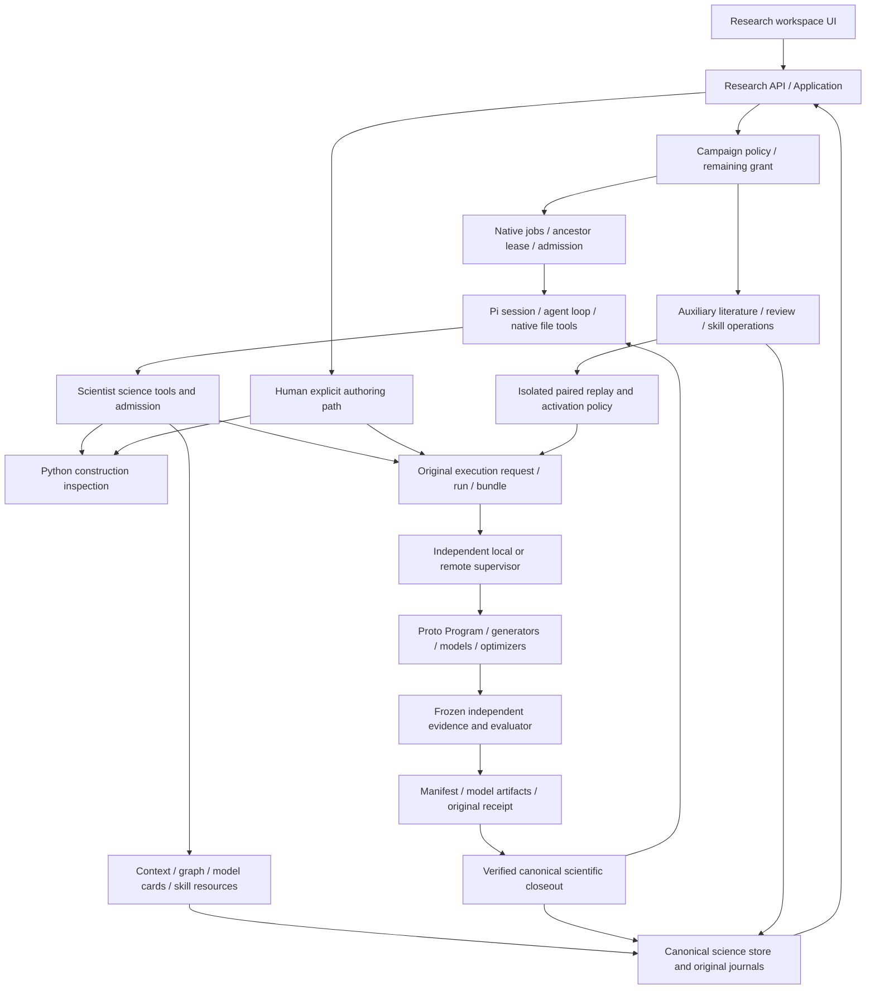

# Whole Autofold harness architecture audit — October 11, 2026

The harness has useful, necessary scientific authority and receipt boundaries, but it still interferes with its underlying tools in several places. The previous extraction improved module ownership; it did not complete the architecture redesign. This audit found concrete admission, cancellation, identity and context-publication bugs, plus competing compaction policies and growing history costs. The first repair batch should address these boundaries before another long campaign.

Four specialist agents covered runtime/Pi integration, durable control/storage/accounting, Proto/scientific execution, and knowledge/skills/product. The primary agent checked their evidence, independently reran admission/cancellation reproductions and measured graph/SDK behavior. This is a source and offline fixture audit of the main checkout, not a live acceptance or a guarantee that every defect has been found.

## Scope and verification

- Main checkout: `/Users/vincentallam/Developer/autofold`. No production code edits, historical reconciliation, server restarts, model downloads, remote calls, paid inference or GPU dispatches.
- Fresh disposable stores, scripted Pi responses and actual pinned CPU Proto fixtures were used. Synthetic records are explicitly fixtures, not measured protein results.
- Eighteen focused worker tests passed: fourteen native-search tests and four evidence-execution tests. The full suite was not rerun for this documentation-only audit. The previous implementation's 579 distinct TypeScript and 103 worker test results remain separate evidence.
- All eighteen prior workspaces match exact before/after logical SQLite records and file hashes. Source and worker fingerprints match before/after exactly.
- Source: `sha256:3e80982fb01fb4f8c7e413d361b42dd79e77946840009aa1030101aac9ef6bcf`.
- Worker: `sha256:35ceb7814aa0979426dbd1c31d14118124c4c2b19705868f6d3c84e94bcb02ec`.
- Full reports, scripts, fixture outputs, inventory and preservation snapshots are saved in `.autofold/whole-architecture-audit-20261011/operator/`. `verification.json` records the exact retained artifacts.

## Current architecture and effect flow

The ordinary path now uses one Pi loop for drafting, validation, repair, execution and evidence review. Validation errors can return to that loop. Autofold's remaining contribution is to supply usable science capabilities and enforce original authority immediately before external effects. It must distinguish a safe draft error from an uncertain model/GPU effect: only the former permits ordinary repair; uncertain effects require original receipt settlement.

The direct human/API authoring path shares execution fencing but currently bypasses some managed-scientist methodology. The diagram shows this difference rather than implying all entry points already have equivalent admission.

| Subsystem | Actual current responsibility | Boundary that needs attention |
| --- | --- | --- |
| Pi runtime | Agent/tool loop, native editing, resource loading, native session tree and summarization | Two live compaction policies; full mirrored histories; setup starts outside runtime duration |
| Scientist lane | Scoped cards/tools, prospective admission, immutable request capture, closeout ordering, stop/research registers | Optional views block reads; original intent mixed with phase projection in `scientist.json` |
| Campaign/jobs | Remaining grants, ordinary/protected replay allocation, parent ancestry and native lease ownership | Session binding commits before job admission; cancelled-job accounting misreads cumulative history |
| Auxiliary operations | Independent effect epoch/outbox and settlement for literature/review/refinement/replay | Canonical commit and filesystem publication need separate success semantics |
| Scientific domain/store | Contracts, trials, runs, evaluations, claims, hypotheses, review decisions and scope | Explicit run collision; writer-locking reads; whole-state operation mutations |
| Execution/transport | Exact program/target/worker/bundle identity, original launch intent, supervision and receipt recovery | Inspection is incompletely contained/bounded; repeated preflight/polling; package-byte attestation gap |
| Proto/model libraries | Scientific composition, generators, constraints, objectives, optimizers and native model execution | Host global profiling/private sampling interception; semantic projections do not capture arbitrary Python dependencies |
| Evidence/evaluator | Independent frozen readout and comparable locked score | Current profile is protein-sequence/structure-proxy specific; timeout units/cardinality need clearer declarations |
| Knowledge/skills | Canonical interpretations plus read-only graph/cards; pinned procedural resources and independent paired activation | Full-history reconstruction/input; incompatible predictor metrics; overly broad bibliographic URL rejection |
| UI/client | Observation, human review/CAS editing, verified artifacts | Full polling and hidden tool errors; generic legacy SDK targets another API |

### Authority is more specific than “canonical versus projection”

`scientist.json` currently contains both authoritative registers and derived fields. Original `requests`, pending evaluation, completed-evaluation, stop and research lifecycle fields drive subsequent actions. Portable phase/iteration/path/memory-revision fields are projections. No complete checkpoint reconstruction exists today; deleting the file would be unsafe.

Likewise, claims, research requests, hypotheses and knowledge cycles in the database are canonical interpretations and decisions. Graph retrieval packets, model cards, JSON views and Markdown exports are projections. `events.jsonl` is currently an authoritative scientific trajectory journal; `EVENTS.md` is derivative. Publication failure must not become an excuse to discard the journal or invent a missing tool return.

Job, session, auxiliary operation and physical worker leases/statuses protect different races. Outcome, cancellation, settlement, accounting and physical shutdown are independent axes. Their duplication in display does not justify collapsing them into one status.

## Ranked findings

Evidence labels distinguish a reproduced bug, a measured local cost, and a source-supported gap. P1 means repair before another broad campaign; it does not assert an observed security incident or remote failure. Exact references and regression details are in the specialist reports.

| ID / priority | Finding and evidence | Narrow repair |
| --- | --- | --- |
| H01 / P1 | **Construction inspection has ordinary Python filesystem effects.** A successful offline import wrote a temporary marker. Inspection receives ambient environment; CUDA/download flags do not contain general Python IO. No credential/network/GPU exploit was demonstrated. | OS-enforced inspection capability boundary: read-only approved inputs/packages, disposable scratch, selected environment, no network/accelerator access. Preserve native Python expressiveness. |
| H02 / P1 | **Inspection is only partly bounded.** `describeTrial` has a timeout; discovery/extract/config checks lack equivalent signal/time bounds, and output is fully buffered. Source gap, no infinite process injected. | One finite subprocess runner with deadline, cancellation, output caps and descendant termination; return bounded diagnostics to Pi. |
| H03 / P1 | **Derivative file failures block context and poison startup.** MODEL_REGISTRY/candidateArchive publication rejects a read with unchanged canonical state. HISTORY publication failure caches the same rejected startup Promise even after repairing the path. Reproduced. | Separate required authority initialization from advisory hydration. Return usable in-memory views plus publication gaps; retry only hydration, never replay effectful initialization. |
| H04 / P2 | **Rejected discovery admission changes durable scientist ownership.** Missing parent rejects with zero jobs but commits session/model binding; a legitimate later identity is rejected. Independently reproduced. | One fenced atomic transaction for idempotency, parent admission and experiment binding. No compensating unbind race. |
| H05 / P2 | **No-admission cancellation confuses prior spend with new spend.** A zero-attempt follow-up settles zero-work but accounting rejects its reused session's earlier attributed $0.125. Independently reproduced. | Persist/prove original job usage intervals or enqueue revision/baseline. Unknown/unattributed usage remains held. |
| H06 / P2 | **Explicit run ID can overwrite another trial's run.** Service fixture leaves the first trial queued without its original run. Normal execution's stable-request path is separately fenced; no duplicate GPU dispatch was shown. | Reject conflicting original binding before transition; identical inputs return the original run idempotently. |
| H07 / P2 | **Two normal compaction policies are live.** Host effective-input chunking and native SDK usage thresholds both reached in separate fixtures, with different checkpoints. No same-boundary duplicate summary proved. | One owner for normal compaction using supported Pi hooks; separate named legacy-import preparation. If required hooks are absent, document one host policy and disable native competing triggers. |
| H08 / P2 | **Runtime duration excludes resource/session setup.** A 50 ms runtime with a 250 ms resource callback completed in ~297 ms and called only a scripted provider. Job absolute grant checks still protect real dispatch. | Start deadline at entry; carry cancellation through setup and dispose late sessions; never reset remaining duration. |
| H09 / P2 | **Original intent authority is split across JSON/checkpoints/execution intent.** Source-supported reconstruction/migration gap. | Add one canonical request register under the existing epoch; cross-check original evidence, preserve ambiguous legacy JSON read-only, derive phase views. |
| H10 / P2 | **Actual billing remains separate from generic SDK estimated cost.** Preserved historical actual $0.118467738 versus estimate $0.170794008; not a new request. | Bind reported actual/unknown, estimate, original generation ID and routed provider separately through the existing Pi adapter. |
| H11 / P2 | **Read-only store observations acquire writer locks/schema admission.** Scoped Autofold read waited ~264 ms behind a 200 ms writer; raw WAL read ~0.13 ms. Local fixture, no lease failure established. | One-time migration plus true read snapshots/shared locks; retain serialized transactional writes. |
| H12 / P2 | **History growth is paid repeatedly in storage/context/graph.** Full session tree plus flat transcript rewrite; full operation histories; every-run receipt scan; quadratic graph joins. Local measurements below. | Append native entries and compact CAS head, indexed receipt/operation links, revision-bound linear views and bounded verification workers. Preserve exact original archives. |
| H13 / P2 | **Native observation globally profiles Python and patches private sampling.** Existing profiler rejected; helper-call microbenchmark 8.63× overhead. No GPU throughput claim. | Supported Proto pre/post-result and generator observers including cached/threaded paths; preserve zero-extra-dispatch tracking. |
| H14 / P2 | **Semantic callable projections omit globals/defaults.** Changing a global coefficient preserves projection. Whole-program hashes still bind original execution. | Explicit scientific function configuration; unresolved dependencies mark comparability unavailable rather than claiming arbitrary Python is frozen. |
| H15 / P2 | **API and scientist methodology differ.** Direct authoring retains scope/budget/evaluator/lease fences but omits several citation/plan/comparator checks. | Shared methodology service with persisted managed-strict, human-explicit and historical profiles. Keep execution authority separate. |
| H16 / P2 | **Executing native package bytes are not uniformly attested.** Remote checks Git HEAD; dirty bytes/import-origin drift not uniformly covered. Source risk, no actual remote drift shown. | One attested package origin/executable-byte identity at inventory/launch; avoid repeated full hashes per context. |
| H17 / P2 | **Budget units and evaluation multiplicity differ.** Stage timeout is per request; reservation sums stages once. Aggregate worker wall deadline still holds. | Explicit wall/resource units and model×candidate×seed cardinality in fresh profiles; keep old contracts frozen. |
| H18 / P2 | **Operator review can commit then return generic failure on publication.** Source-confirmed path, distinct from reproduced read failure. | Return committed record/hash plus independent pending publication status; retry deterministic export only. |
| H19 / P2 | **Predictor disagreement mixes incompatible metrics/unpaired seeds.** Synthetic ipTM .8 versus confidence .2 at different seeds yields range .6. It does not alter locked scores or directly activate a guide. | Reuse paired EvidenceView identities/metric semantics; incompatible data is noncomparable, not thresholded disagreement. |
| H20 / P2 | **Input and polling costs are poorly bounded.** Literature can return 2 MiB; replay arms receive full history; UI repeatedly fetches full state; local supervision requests status/adopt/status around 25 ms sleeps. Source paths, not measured paid cost. | Source handles/pages, bounded common replay packets, revision/cursor/per-tab reads, adaptive supervisor monitoring; adopt only when needed. |
| H21 / P2–P3 | **Capability/product contracts obscure reality.** UI hides all tool results and suppresses session errors; fresh tool schemas include aliases; text-only read advertises images; skill regex rejects DOI links. Generic SDK `/session`404 is intentional legacy API mismatch. | Truthful errors/loadouts, internal historical alias mapping, inert attribution links, typed current Research API client and explicit legacy packaging. |

### Concrete growth measurements

These are synthetic CPU/local SQLite fixtures, not production latency targets or GPU results.

| Fixture | Small history | Larger history | Implication |
| --- | --- | --- | --- |
| Full mirrored session save, 20 repeated writes | 20 messages / 0.417 MB: 0.75 ms/write | 600 / 12.49 MB: 23.15 ms/write | Compaction shrinks model context but does not remove repeated whole archive persistence |
| Graph query returning just one node | 100 trials: 10,000 evaluation/run checks, 9.25 ms | 3,000: 9,000,000 checks, 229.71 ms | Output pagination does not bound reconstruction work |
| Python helper returns under native observer | 300,000 calls: 0.010551 s | Observed: 0.091055 s | Global lock/profile work affects unrelated Python calls; GPU impact remains unmeasured |

The backend inventory totals 138 production TS/Python files and 26,341 lines across engine, science-core and worker. Frontend, generated SDK and utilities are inventoried separately. Line count is not evidence of unused code or shipped bundle size: translations, generated compatibility APIs and frozen adapters need consumer tracing before removal.

## Target harness: one owner for each behavior

No new microservice, scheduler, event bus, agent framework, DAG or LLM client is justified by this audit. Keep the existing components and narrow their ports.

| Owner | Owns | Receives from Autofold | Must not take over |
| --- | --- | --- | --- |
| Pi | Reasoning/repair loop, native tools, resources, session tree and one compaction policy | Science capabilities, confinement, authorization/cost hooks, immutable reference handles | Scientific score interpretation, original GPU settlement or campaign allocation |
| Proto and model libraries | Rich program composition, objectives, constraints, optimizers, model-specific execution | Attested environment, selected resource capability, supported original-result observer | Grant authority, independently frozen evaluation or guide promotion |
| Autofold science pack | Model cards/readiness, methodology profiles, target/evaluator identities, evidence interpretation and procedural skills | Canonical verified inputs and permitted native capabilities | A second generic reasoning loop or replacement Python language |
| Autofold execution authority | Atomic original request admission, independent effect epochs, grant checks, supervision and exact receipts | Program bytes, explicit budgets/profile and original request ID | Optimizer heuristics, generic file matching or evidence-free retries |
| Autofold persistence | Canonical science/request records, native entry append/CAS, journals, typed accounting and immutable evidence | Exact original events and trusted closeouts | Hidden session initialization or authority inferred from derived files |
| Views/API/UI | Pure revision-bound cards, pages, typed observations and human CAS review | Committed state, verification/publication status and cursors | Dispatch, settlement or fabricated success after a failed read |

### Intended ordinary and recovery paths

Ordinary: Pi authors → bounded contained inspection → same-loop diagnostics/repair → atomic original intent → final authority check → one supervised execution → verified receipt → canonical trusted tool closeout → next Pi turn. Derived context publication can fail independently without lying about receipt availability.

Recovery: inspect current original durable identity → verify ownership/deadline and exact original receipts → supported parent-first receipt settlement → canonical closeout. Missing identity or unknown billing remains held. Recovery never initializes a missing model session, creates a replacement or assumes physical absence is success.

## Repair and migration sequence

### 1. Fix demonstrated boundary bugs offline

Repair H03–H06, complete finite inspection bounds H02 and move runtime deadline entry H08. Add exact-snapshot rejection tests, reused-session cancellation attribution, conflicting/original run identity tests, projection-failure repair and no-new-effects setup cancellation. Required journal/contract corruption must still fence execution. These fixes do not require broad architecture migration or paid runs.

### 2. Contain inspection and establish actual environment identity

Implement H01/H16 with real OS capability enforcement and package-origin/byte attestation. Test permitted scratch/read behavior, forbidden writes/recipients, descendant termination, huge output and wrong install/dirty source in disposable fixtures. Test actual supported macOS/Linux boundaries; an environment variable is not isolation. Preserve native language freedom inside the declared capability scope.

### 3. Consolidate runtime and durable original state deliberately

Resolve H07/H09/H10–H12. Choose one compaction owner; append native entries with small atomically fenced metadata; use true WAL reads and indexed exact-operation/receipt bindings. Integrate actual/estimated/unknown usage without changing provider clients. Migrate additively with schema versions, explicit legacy readers and reversible projections. Every uncertain original effect retains its identity and held state.

Before deleting either stored history or `scientist.json` registers, test reopen/crash around assistant intent, tool start, launch intent, receipt arrival, trusted closeout, accounting and compaction commit. Cross-process CAS, cancelled ancestry, lease loss and unknown billing must not produce another model/GPU dispatch. Exact old archives stay audit-readable.

### 4. Make science and retrieval explicit and bounded

Implement immutable inspection caching, linear graph/knowledge indexes, receipt-revision caches, bounded source/replay pages and supported Proto observation. Reuse metric pairing semantics; declare methodology/science profiles and budget units. Broader readouts/chemistry/assay objectives require a new profile rather than weakening the current evaluator. Model registration, installation readiness and scientifically suitable use remain different facts.

### 5. Align product contracts and validate the result

Expose native tool failures/repairs and stale observations; publish a current typed Research API with contract tests; isolate retained legacy SDK/tool/DAG consumers. Use cursor/revision APIs and active-tab reads. Keep an explicit full audit endpoint.

Validation should first prove repair-to-validity inside one Pi session, zero duplicate effects, truthful original cost attribution, bounded work as history grows, matched native result equivalence and receipt-only reopen. Only then use a fresh explicitly authorized inference/GPU comparison. A long run is a final endurance check, not the first way to discover an atomicity bug.

## Safeguards and limitations

Keep original immutable program/target/evaluator/worker identities, independent leases/supervision, ancestry fences, unknown-effect/accounting states, prospective scientific interpretation, valid-only independent paired guide evidence and receipt verification. These complement Pi/Proto because those tools do not know the scientific grant or historical comparison contract.

Keep historical executors and evaluator sources available for frozen receipts until consumer-traced migration proves they can be isolated further. There is no evidence that deleting the job layer, supervisor or frozen scoring panel would improve the harness.

Current native hill-climb energy, structure-confidence metrics, locked comparison score and biological activity are different axes. One-candidate fixed-seed surrogate evaluations and small samples do not prove biological benefit, universal model compatibility or causal graph/skill improvement. No live authoring, GPU throughput, remote failure matrix, browser performance or new provider bill was measured in this audit.

## Detailed evidence

- [Runtime/Pi audit](../../.autofold/whole-architecture-audit-20261011/operator/autofold-whole-architecture-runtime-audit-20261011.md): SDK ownership, compaction, setup duration, persistence and resources.
- [Durable control audit](../../.autofold/whole-architecture-audit-20261011/operator/autofold-whole-architecture-control-audit-20261011.md): atomicity, identity, cancellation, leases, accounting and storage.
- [Proto/science audit](../../.autofold/whole-architecture-audit-20261011/operator/autofold-whole-architecture-science-audit-20261011.md): inspection, native observation, science profiles, evaluator and transport.
- [Knowledge/product audit](../../.autofold/whole-architecture-audit-20261011/operator/autofold-whole-architecture-knowledge-product-audit-20261011.md): projections, literature, graph, feedback, replay and UI.
- [Exact verification](../../.autofold/whole-architecture-audit-20261011/operator/verification.json): source/preservation checks, saved artifact hashes and audit effects.
