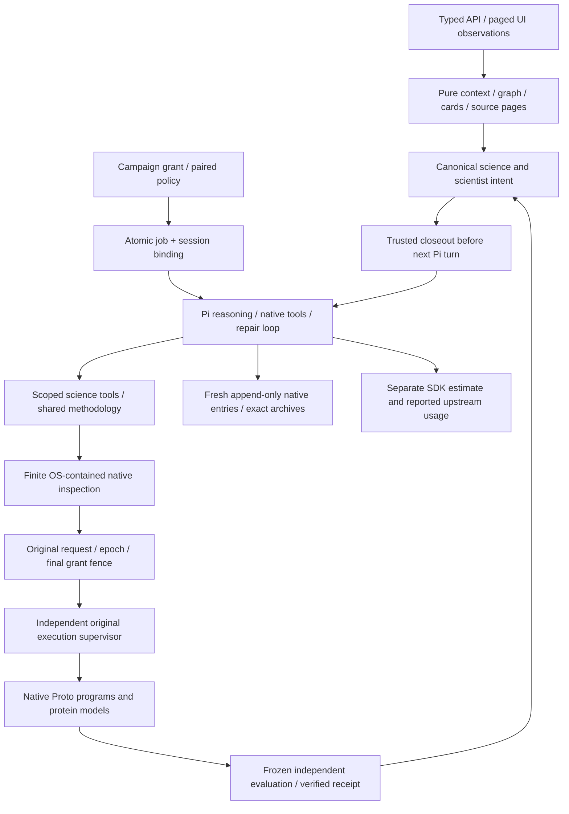

# Whole-harness repairs — October 11, 2026

Autofold now separates agent behavior, scientific execution authority, canonical intent, and derivative views more clearly. Pi keeps the reasoning/tool/repair loop. Proto retains rich native programs, generators, objectives, constraints and optimizers. Autofold supplies scoped science capabilities, shared methodology, finite inspection, atomic admission, immutable identity, independent receipts and truthful accounting. No replacement agent loop, DAG, scheduler or service was added.

This implements the [whole-harness audit](whole-harness-audit-2026-10-11.md) in the main checkout. Three specialist implementation agents covered durable control, execution/science, and knowledge/product; the primary agent handled runtime, fresh append storage, billing metadata and integration. Independent cross-reviews found additional lease, late-callback, read-snapshot and native-declaration capture races; those received explicit regressions. The original audit and historical acceptance decisions remain separate evidence.

## Resulting boundaries

Context reads no longer replay pending scientific actions. Required frozen inputs and JSONL journal integrity remain hard authority boundaries; failed Markdown/JSON/card exports become independent publication gaps. Publication repair never invents a scientific result or repeats inference. Nonempty unknown legacy scientist registers remain held without automatic migration.

Fresh session projects use immutable entry/message appends and a compact CAS head. Existing legacy stores retain their original writer and format. Compatibility readers reconstruct both formats; read-only session observations open neither a writer nor a missing database. A legacy writer refuses an append-format database. CAS, receipt uniqueness, archive completeness and original identity are checked transactionally. Related head/archive reads share one WAL snapshot.

Pi's native threshold/overflow lifecycle and exact-input guard invoke one constrained compaction function through supported hooks. Both triggers preserve exact archives and commit the checkpoint before continuation; the native default summarizer is not a competing policy. Whole-run duration begins before setup. Cancellation and lease loss interrupt setup; late SDK completion cannot publish or dispatch. Noncooperating event observers have bounded backpressure, and late provider callbacks cannot mutate a terminal request or a later owner.

SDK static-price estimates and explicit OpenRouter-reported costs are separate typed fields. Reported metadata binds original host/upstream request IDs, routed provider and accumulated usage evidence. Unknown actual usage stays null; a genuine reported zero stays known. Parent/child aggregation uses original request baselines and unique attribution, not cumulative-session guesses. Both estimate and known reported-cost ceilings apply independently. No invoice equality is inferred from static SDK prices.

## Audit disposition

| Finding | Implemented repair | Remaining limit |
| --- | --- | --- |
| H01 | Selected environment and OS capability boundary, enforced before authoring | This managed macOS environment rejects sandbox-exec. Production fails closed; positive containment must be proven on the execution host. Linux adapter is untested here. |
| H02 | Whole inspection lifecycle deadline, signal, output caps, bounded cleanup and process-group kill | Escaped-descendant exit and universal RAM/CPU isolation are not proved. |
| H03 | Pure reads; required authority separate from advisory hydration/publication; retry failed caches | Required corruption still blocks; export availability is not receipt validity. |
| H04 | Atomic ancestry-fenced enqueue and experiment/session/model binding | No compensating unbind or orphan inference. |
| H05 | Exact original usage intervals and baselines for reused-session cancellation | Unknown or unattributed earlier spend remains held. |
| H06 | Conflicting explicit run IDs rejected; identical original binding idempotent | No identity-based permission to change original compute. |
| H07 | One science-constrained compaction function integrated with Pi lifecycle | Exact-input and native usage thresholds are separate triggers, not separate summarizers. |
| H08 | Entry deadline, abortable setup, late-completion and lease-loss fences | Arbitrary blocking host code and persistence IO are not universally preemptible. |
| H09 | Canonical scientist request register under original epoch/CAS; JSON derived | Ambiguous legacy authority is preserved, not automatically migrated. |
| H10 | Separate reported usage/identity/unknowns and SDK estimates throughout runtime and accounting | Offline fixtures prove semantics; no new live provider/invoice acceptance. |
| H11 | Explicit write initialization, true WAL science reads and readonly session observations | Writes remain serialized intentionally. |
| H12 | Fresh append storage, scoped operation mutations, linear graph joins, bounded verification/context | Full history reconstruction remains linear; no complete incremental/indexed read model or legacy conversion. |
| H13 | Python 3.12 public code-local monitoring; existing profiler preserved | Private sampler compatibility hook and older-Python fallback remain pending upstream ports. |
| H14 | Globals/defaults/closures represented; unresolved dependencies explicitly noncomparable | Arbitrary Python equivalence is not claimed. |
| H15 | Shared managed-strict/human-explicit methodology; native-only declaration capture then strict validation | Profiles express intentionally different evidence requirements; historical profile cannot admit fresh work. |
| H16 | Native source-byte/import-origin attestation, including ignored/untracked Python shadows | Third-party wheels, model caches, drivers and universal bytecode integrity are outside this attestation. |
| H17 | Explicit positive model-stage deadlines, wall units and model × candidate × seed cardinality reservations | Conservative elapsed-wall reservations are not measured GPU utilization. |
| H18 | Canonical review commit returned with independent publication status | Failed mandatory commit remains failure. |
| H19 | Compatible metric/stage/candidate and paired seed comparisons; duplicates noncomparable | Descriptive disagreement is not calibrated ensemble or biological evidence. |
| H20 | Frozen source handles/pages, common replay history pages, transcript cursors/tab reads and adaptive polling | Individual giant legacy messages and some whole UI/store projections remain. |
| H21 | Native fresh tools, explicit historical aliases, truthful reader/citations, visible errors/stale transcript | UI client/API/build checked; no browser acceptance or server restart. |

Native file authoring keeps Pi's original write/edit tools and adds scoped pre/post-byte receipts. Acceptance reconstruction uses Pi's supported edit primitive over in-memory bytes, including its simultaneous edit and normalization semantics, instead of a second edit interpreter. Original journal arguments, path, start/end correlation, prior content and canonical captured program hash must agree; an unjournaled mutation cannot receive authorship credit.

## Local storage measurement

A synthetic in-memory SQLite fixture wrote the same immutable archive twenty times while advancing only the journal/head. At 600 messages / 9.88 MB, the retained snapshot writer took 11.87 ms per write; fresh append storage took 0.39 ms. At twenty messages / 0.33 MB, results were 0.40 ms and 0.04 ms. Exact archives were preserved in both cases. This measures repeated immutable-prefix persistence only, not complete agent latency, disk durability performance or historical migration. Reads still reconstruct archives linearly. The fixture/script are retained with the evidence.

## Verification

Final checks cover **656 distinct TypeScript cases passed, one optional legacy fixture skipped, and 112 worker tests passed**. The full integration command completed with 646 pass / 1 skip / 1 architecture import failure. That import was moved behind the runtime port and the architecture/provenance/file-tool checks passed 9/9. Subsequent original-provider/deadline fixes passed 116/116 focused integration cases and 95/95 runtime cases. `test-ledger.json` reconciles final status by file/test name, retaining the failed raw run; this is not a claim that the original full command was all green. Backend, SDK and UI typechecks and the UI production build passed. A 100 ms legacy renewal fixture exposed CPU/GC scheduling sensitivity; its lease margin is now 300 ms, while its >300 ms buffered stream still must renew repeatedly and exclude a competitor. Actual lease-loss and replacement tests retain their fences.

Independent followup also verified that every store binds raw upstream IDs to one original session/request before continuation, preserves the binding across reopen, rejects raw/verified disagreement, and rolls back conflicts. Receipt-only usage recovery cannot replace an already-known upstream identity. Monotonic expiry checks immediately before host/provider effects prevent dispatch after blocking setup/credential work delays timer callbacks; they cannot preempt arbitrary synchronous host code.

Final production source: `sha256:48f6b06326d06ddcbd41e79c6bd26a81663f3243ffffce8a714e54af035b66cb`; worker: `sha256:6bf687d0a09fa0191f115649464600ed17311363a837bab5e451a969d6ef08e1`. All nineteen historical workspaces match exact logical database and file snapshots.

Final combined verification and exact source identities are recorded in `.autofold/whole-harness-repair-20261011/operator/verification.json`. Full logs include earlier failed integration runs and their corrected final checks. Synthetic provider replies and explicitly labeled trusted CPU adapters do not establish production OS confinement, live provider billing or learned-model quality.

No paid LLM inference, GPU dispatch, remote calls, model downloads, server restarts, commits/pushes, historical reconciliation or prior-grant resumption occurred. Nineteen prior workspaces are compared by logical SQLite records and original file hashes. Existing legacy data is never implicitly converted.

The next live campaign requires a working positively validated inspection boundary on its actual execution host. Remaining scaling work is an incremental indexed read model; remaining Proto integration work is a supported upstream sampler/result observer port. These are explicit limits, not new layers hidden inside the agent loop.
