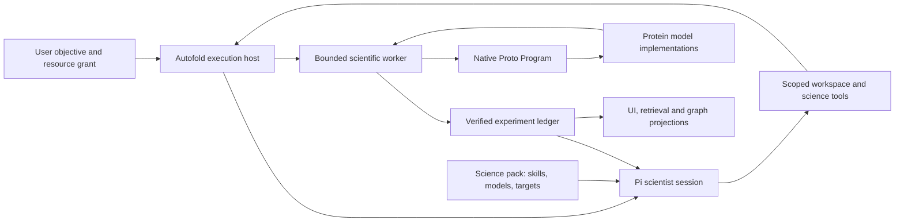

# Autofold: protein-science harness around Pi and Proto

Status: native Pi integration, scientist responsibility separation and the Proto inspection boundary are implemented and verified offline. See [the implementation and verification](../architecture/subsystem-boundaries-2026-10-11.md). The drift inventory below records the pre-refactor checkout. Later protocol/profile changes, removal of historical executors, native persistence migration and provider billing integration remain explicit separate work; this document does not authorize inference or compute or replace prior acceptance decisions.

## Product invariant

A scientist should be able to inspect a biological problem, choose suitable models, express a scientific program, test it, diagnose errors, revise it and learn from the resulting evidence. Autofold makes that work accessible, bounded, attributable and reproducible. Pi supplies the agent runtime; Proto supplies scientific programming and composition; protein model implementations supply their own algorithms and input semantics.

A custom Autofold mechanism needs a concrete reason: protein-science semantics, resource authority, provenance across external effects, or product presentation. Generic agent behavior, editing, orchestration inside a scientific program and model algorithms should come from those underlying tools where their actual interfaces support the requirement. A wrapper should add capabilities and preserve semantics. An unavailable upstream capability is an explicit integration gap rather than a reason to silently invent a different scientific language.

“Thin” means clear ownership and few crossings of a boundary. It does not mean deleting receipts, locks or evidence validation because they take many lines.

## Observed current drift

| Current code | Evidence from this checkout | Boundary consequence |
| --- | --- | --- |
| `engine/src/scientist/index.ts` | 992 lines including workspace files, a long system prompt/API document, budgets, graph access, declaration admission, pending requests, execution and interpretation | A science tool facade has become several subsystems; changes to capabilities can affect agent interaction and recovery together. |
| `engine/src/runtime/sdk.ts` and `runtime/index.ts` | The SDK is embedded, but `ResourceLoader` returns empty skills/prompts/extensions, uses `cwd: '.'`, and the host supplies resources separately. SDK entries and message projections are persisted in Autofold's store. Host hooks enforce budgets and context retention. | Some mediation is required for grants and durability; suppressing useful native resource/tool interfaces causes avoidable replacement code. The bridge needs an explicit ownership contract rather than blanket removal. |
| `engine/src/scientist/index.ts:508–549` | Custom read/write/edit/list/search implementation; edits require an exact string match once | Generic editing behavior is owned by the science layer. The installed Pi SDK exports file-tool factories with injectable filesystem operations. |
| `science-core/src/research/trial-reasoning.ts` and scientist admission | A detailed alternatives/outcome-branches decision plan is required for ordinary evaluation and references are checked against persisted scoped records | Useful methodological expectations are coupled to executable admission. Keep evidence integrity; make the chosen scientific protocol explicit instead of requiring one reasoning form for every micro-experiment. |
| `science-core/src/research/workflow.ts` | 781 lines combine scientific policy, legacy stage/routing schemas, native metadata compilation and Python inspection subprocess calls | The nominal science domain contains both execution integration and an additional workflow representation. Native inspection should be an execution adapter; new scientific composition should remain Proto code. |
| `engine/src/campaign/index.ts` and `campaign/policy.ts` | 736 and 543 lines respectively; allocation, choosing/binding experiments, refinements and child settlement are mixed | Campaign resource admission and scientific next-action policy need separate ownership. The allocator must not prescribe the agent's reasoning process. |
| Job/session/run/operation/kernel records | Native job lifecycle is copied into an operation diagnostic record; the scientist has pending requests and a kernel projection; Pi has its own session ownership | These records describe different axes. Explicit owners and derived projections are needed, not either a single misleading status or independent copies that can each authorize progress. |
| Worker native and compatibility execution | Native search and direct evidence sequencing coexist with `compatibility/evidence_dag.py` and frozen legacy adapters | Historical executors must be isolated. They should not shape the fresh authoring API. Removing them requires measured parity or a versioned new-contract boundary. |

Inventory: the three production source trees contain 61 engine files / 10,774 lines, 35 science-core files / 9,463 lines and 32 worker Python files / 5,847 lines, excluding TypeScript test files and Python caches. This is a scope measurement, not a dead-code estimate; compatibility, fixtures and product behavior are included. No percentage of this code is declared safely removable merely from size.

The October 11 Pi science-layer change already removed discovery's evaluation-only no-progress/re-prompt loop and corrected external generator metadata. That is a local repair, not completion of this architecture.

## Ownership we should adopt

| Owner | Owns | Autofold's integration |
| --- | --- | --- |
| Pi | Agent/tool loop, ordinary editing behavior, session tree, semantic compaction, progressive skill/resource loading | Bind a scientific workspace, supply scoped resources and scientific tools, observe events and enforce explicitly granted effects through supported hooks. |
| Proto | Scientific Program composition, generators, constraints, objectives, optimizers and supported native execution semantics | Pin the installed runtime, inspect/admit native programs, bound execution and record original outputs. Do not make the scientist write a second general workflow language. |
| Protein models and their adapters | Model inference, native input/config semantics and emitted model outputs | Expose capabilities and actual adapter support; preserve chemistry/MSA/template inputs; capture versions, resource use and limitations. |
| Autofold science pack | Protein-science skills, model cards, target references, scientific protocol and benchmark/evaluator plugins | Provide the scientist with useful terrain knowledge and verifiable scientific measurements. Guidance is distinguished from mandatory host authority. |
| Autofold execution host | Admission, original identity, deadline/resources, dispatch/cancellation, receipt collection and spend evidence | One external-effect boundary with original-ID recovery. Do not infer that a failed controller means a failed model run. |
| Autofold experiment ledger/product | Durable programs, candidate identities, run receipts, assessments, graph retrieval and UI/API projections | Distinguish measurements, interpretation and unresolved effects. UI/CLI do not create another discovery loop. |

These are responsibility areas, not a proposal for separate microservices. Start in the existing process and worker with narrow interfaces. Do not add a general plugin framework, event bus or second orchestration runtime just to rename the existing classes.

Pi decisions reach the host only at an authorized effect boundary. Proto and model code execute in the worker. Retrieval supplies evidence and guidance to Pi; it does not issue commands to the worker.

## Narrow public contracts

Keep these explicit and versioned; the names below describe the proposed contracts rather than new implemented APIs.

1. **Experiment specification plus separate resource grant.** The specification binds target identity, requested modality/input features, scientific question and scoring/comparison protocol. The grant binds authorized recipients, time, inference/compute budgets and output allowances. The scientist can change internal optimization code within these bounds; it cannot rewrite the frozen scoring protocol or enlarge authority.
2. **Program reference.** A captured native Python/Proto program identified by exact bytes/hash and its environment. Optional hypothesis, prospective plan and interpretation are scientific records, not a second executable manifest. Required preregistration belongs to an explicitly selected experiment protocol; existing experiments retain their original rules.
3. **Run handle.** `submit`, `inspect`, `cancel` and receipt-only `reconcile` refer to the exact original run identity. Submission records intent before the external effect. Inspection does not initialize sessions or allocate work. Cancellation and controller failure do not imply a terminal remote outcome.
4. **Observation receipt.** Original artifacts, candidate identity, model versions/configuration, validity, nullable metrics, locked evaluator output and actual/estimated/unknown usage are separate fields. Agent interpretations reference that receipt; they cannot edit or substitute for it.

SDK messages and search histories are not extra public lifecycle protocols. They remain native data, addressable through scoped references. Avoid duplicating rich native optimizer histories into parallel Autofold search objects merely to render them.

## Scientific freedom versus verification

The scientist should express generation, inverse folding, structure prediction, filters, hard/soft constraints, objective functions and optimization through ordinary native Proto code and its real supported model adapters. Autofold's model registry derives callable capabilities from the pinned upstream registry and adds scientific applicability/adapter readiness. Procedural skills explain model selection and experimental controls; they do not prescribe a universal pipeline.

Enforce executable bounds, genuine input support, frozen score comparability, actual citation scope and honest evidence. Put recommendations about alternative selection, hypothesis formulation and when to seek literature in procedural guidance. Where preregistration or protected independent paired replay is part of an approved experiment, enforce that explicit protocol. Do not retroactively relax existing contracts, guide activation rules, scientific outcomes or historical evidence.

Hard output validity and scientific quality are separate. A high confidence surrogate is not binding evidence; a completed job can have zero scientific evaluations; a rejected candidate can be informative. The product should show these distinctions directly rather than equating `job.succeeded` with successful science.

## Persistence and authority

Assign one authoritative owner to each axis:

- Pi session tree: the SDK's native representation. UI history, search indexes and context cards are derived views. Keep the current storage bridge until crash-safe native persistence and protected-intent preservation are demonstrated; do not replace SQLite with JSONL by assertion.
- Job admission: the execution host's grant and lease. Session and worker leases remain independent where they protect independently mutable effects.
- Remote/local run: the original worker intent and receipt. Recovery collects this identity without another inference call or replacement launch.
- Measurements: verified run artifacts plus the frozen evaluator.
- Interpretation, questions and skill candidates: scientist-authored records with explicit epistemic labels.
- Knowledge graph, kernel status and operation UI: projections unless a specific axis is explicitly their authority. A projection failure must not undo committed science or require another model turn.

A displayed status must preserve execution outcome, scientific validity, interpretation and resource settlement separately. Consolidation must never flatten “unknown receipt” or “unknown billing” into failure, zero cost or successful completion.

## Concrete migration order

| Stage | Change | Proof before retiring the old path |
| --- | --- | --- |
| 1. Native Pi integration | Use Pi read/write/edit implementations with confined filesystem operations; provide a scoped loader for pinned skill/resource snapshots; use the real experiment workspace. Reduce the system prompt to durable scope and essential scientific rules. | Same access restrictions, exact captured program bytes, serialized mutation behavior, useful edit feedback, lazy skill reads, stop/cancellation and no ambient operator-resource discovery. Tool aliases retain old transcripts. |
| 2. One science tool facade | Extract workspace policy, capability discovery, declaration validation, execution requests and evidence access behind the existing tool entry points. All UI/SDK paths use that facade. | Same job/session identity, request idempotency, graph/citation scope, original trusted closeout and no duplicate evaluation. Extraction does not add a new lifecycle. |
| 3. Separate protocol from agent procedure | Expose current required study protocol explicitly; for new versioned experiment profiles, reduce ordinary execution metadata and place optional reasoning guidance in skills. Campaign allocation handles residual grants and supported study boundaries rather than reprompting. | Existing strict experiments unchanged; new profiles enforce comparability/validity; interpretable decisions and candidate independence remain auditable. This is a scientific protocol change, not an invisible compatibility cleanup. |
| 4. Narrow the Proto boundary | Move Python inspection/discovery orchestration out of the science domain into the execution adapter. Make native programs the fresh scientific authoring representation; isolate compatibility DAG/wire translators. | Native semantics, objectives, routing when supported, output selection and evaluator provenance are preserved. Keep historical handlers until actual equivalence or an explicit versioned boundary is established. |
| 5. Consolidate evidence/accounting projections | Keep one SDK transcript authority and one original request/run authority per effect. Rebuild graph/context/UI records from verified facts. Preserve actual provider usage separately from estimates. | Controller-kill/original-receipt recovery, unknown billing, exact upstream identity, no duplicate launches, partial outputs and zero-effect reopen all pass. Fix the existing OpenRouter actual-cost/static-estimate mismatch without building another provider client. |

For each stage, migrate current consumers, then remove the replaced code. A new wrapper that delegates to the old implementation without retiring duplication is not completion. Do not turn this migration into another monolithic rewrite.

A fresh bounded autonomous validation should follow offline parity before another long-range campaign: diagnose an invalid draft, repair through Pi, execute one native program, inspect evidence and shut down with matching receipts/accounting. An externally requested model call needs fresh inference authorization; no paid run is included in this proposal.

## Evidence and open questions

This assessment reads the main checkout and the installed Pi 1.0.1 SDK, not a claim about undocumented future upstream behavior. SDK `createReadTool`/`createWriteTool`/`createEditTool` expose custom filesystem operations; `ResourceLoader` exposes scoped skills/prompts/context files. These are concrete available integration points.

Primary local evidence: `backend/engine/src/runtime/sdk.ts`, `runtime/index.ts`, `scientist/index.ts`, `campaign/index.ts`, `campaign/policy.ts`; `backend/science-core/src/research/workflow.ts`, `trial-reasoning.ts`, `operations.ts`; `backend/worker/autofold_worker/native_search.py`, `proto_model_registry.py`, `remote_supervisor.py`, `evidence_execution.py`; installed SDK `dist/core/tools/{read,write,edit}.d.ts` and `dist/core/resource-loader.d.ts`.

Open questions need measured proofs, not new abstractions: which native resource-loader snapshot is sufficient for learned-model authoring, which conditional evidence paths can be represented natively, and whether native session persistence can meet the existing original-effect recovery guarantees with less host code. All recorded receipts, study outcomes, provider routing decisions and older unresolved identities remain historical evidence. This design claims no new scientific improvement, bloat-removal percentage or live acceptance.
