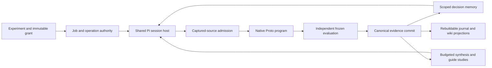

# Autofold cohesive engine design

Status: stages 1–7 implemented, October 12, 2026. Offline regression gates passed. The resumed bounded live GPU run completed all functional checks, with a recorded WSL2 per-process telemetry limitation. Original scientific contracts, historical judgments, receipts and closed grants retain their identities. The earlier paid validation request with unknown billing remains unresolved, and its paid jobs remain held.

Autofold connects scientific reasoning, native search and accumulated evidence in one discovery engine. Pi supplies reasoning and authoring. Proto supplies scientific computation. Memory supplies relevant experience. Autofold owns scientific identity, resource authority, independent evaluation and durable evidence.

The implementation has one shared program admission kernel, one original-effect settlement protocol and one decision memory vocabulary. Jobs, operations, Pi sessions and native runs retain distinct purposes and identities. They cooperate through explicit boundaries rather than sharing a universal task object or execution language.

## Ownership

| Responsibility | Owner | Autofold integration |
| --- | --- | --- |
| Conversation tree, model and tool loop, editing, ordinary repair, progressive skills and semantic compaction | Pi | Scoped resources and tools, composed native hooks, request authorization, durable session bridge and usage receipts |
| Constructs, generators, model composition, constraints, objectives, optimizers and internal search | Native Proto | Contained construction inspection, exact native descriptors, supported scoped lifecycle admission and artifact capture |
| Scientific objective, experiment identity, comparison protocol and grants | Autofold | Immutable contracts, explicit policy and resource reservations |
| Independent evaluation of submitted outputs | Frozen Autofold evaluation policy using native model implementations | Frozen inputs/configuration, candidate/model/seed invocation census, isolated scoring and original request receipts |
| Observations and their provenance | Scientific ledger | Verified execution/evaluation lineage and immutable artifact references |
| Interpretation, hypotheses and proposed guidance | Scientist or budgeted synthesis through Pi | Attributable revisions, source scope, contradictions and explicit evidence limits |
| Retrieval and delivery | Decision memory projection over the ledger | Bounded qualified facts, exact source manifests and scoped expansion |
| Scheduling, ownership, cancellation and recovery | Existing job and operation kernel | Original identities, epochs, grants, independent settlement axes and outbox |

The scientist chooses the question and intervention. Proto executes the search expressed by the scientist's native program. Autofold admits that work and independently measures its selected outputs. Memory supplies evidence and interpretation; it does not grant compute or change a scientific contract.

## Engine composition

`Application` remains the composition root. Scientific services are shared by the application surfaces. `OperationService` remains the authority kernel; the refactor introduces no second scheduler, task database, replacement provider client or universal molecular representation.

Four integration seams organize the engine:

1. The **session host** binds a Pi session to its existing operation, immutable inputs, model selection, allowed capabilities and cumulative allowance.
2. **Program admission** consumes exact captured source and a scientific snapshot, validates its native construction, and returns the admitted artifact and protocol.
3. **Execution and settlement** reserve authority, dispatch original effects and reconcile those effects' original receipts.
4. **Memory delivery** supplies verified facts and attributable interpretation from one scoped source inventory.

Each controller retains its domain decisions. Sharing those seams does not confer another controller's authority.

## Frozen scientific inputs and live authority

Scientific inputs and permission to act are separate bindings. A snapshot binds the experiment/evaluator, exact eligible evidence identities and hashes, assigned guide versions, source cutoff, frozen target/API references and scientific protocol. Discovery can obtain a new current snapshot between decisions while retaining its experiment contract. Replay captures one common snapshot and supplies exactly its assigned guide to each separate session/workspace.

The operation handle binds the lease, epoch, cancellation, immutable grant, deadline and remaining reservations. New durable intent, external dispatch and discretionary decisions recheck live authority. An admitted artifact alone cannot authorize execution. After cancellation or expiry, settlement authority can verify original receipts and repair deterministic lineage; it cannot launch another effect or make a new scientific decision.

Original request IDs and session baselines survive resume. Missing historical baselines, absent dispatch proof and unknown billing remain unknown. A frozen replay snapshot cannot read later or sibling results, and an old valid snapshot cannot confer new compute authority.

## Shared Pi session host and context lifecycle

`PiSessionHost` is used by scientist jobs, campaign coordination, refinement/replay, literature and knowledge review. It verifies the original session/model/launch metadata, stores its binding beside existing controller progress, and centralizes baseline subtraction, cumulative allowances, remaining deadline and receipt-only resume. It creates no new lease or task entity. Domain callbacks retain operation/ancestor authorization and typed handoff decisions.

Every original model request, including compaction, is attributed to its owning operation binding. Reported provider cost, SDK estimate, unknown requests and enforced ceilings remain distinct. Receipt-only recovery cannot create a missing session or authorize inference. A finished dialogue is not an accepted program, guide or evaluation.

The runtime composes Pi's installed `beforeToolCall`, `afterToolCall`, context transform and finish hooks. Native interception runs before host tool authorization and reservation, and native result normalization is preserved. Native extension events `session_before_compact` and `session_compact` connect compaction to durable archival checkpoints. Pi owns its conversation tree, semantic summarization, overflow retry and continuation. The SQLite bridge persists that tree and original request/tool intents under existing ownership; transcript and archive exports remain projections.

Oversized tool returns become bounded artifact cards through native context edits. The original result remains hash-bound to its session, entry, tool call and ordinal; `read_tool_artifact` pages exact original bytes. `read_context_archive` similarly expands exact archived ranges. These resources do not create another conversation authority or replace scientific receipts.

Compaction uses Pi's native preparation/cut and summary APIs over the active projection. The old custom policy retaining whole scientific tool groups has been removed. Exact human instructions and system constraints remain byte/hash-bound and are restored in chronological order through compaction, transforms and the provider payload boundary. Host-generated context has an explicit origin tag rather than being mistaken for a human instruction. If protected instructions alone exceed the input allowance, execution fails conservatively; a generated summary cannot substitute for them.

## Shared program authoring and admission

Discovery and replay author through Pi's native read/write/edit tools, the same guidance/template and the same validation/submission capture. Replay uses separate workspaces and sessions. Frozen targets, API references, common evidence and assigned guidance are read-only resources; one arm cannot access another arm's program or future evidence.

`inspectScientificProgram` consumes the captured source object. Discovery wraps it with branch integrity and current skill policy; replay supplies its frozen admission state and exactly assigned guide. Replay no longer accepts a whole program string through a parallel submission mechanism or reuses discovery's live-history defaults. Submission validates and persists the same source bytes that were captured.

Admission returns exact program/runtime identities, an actual native construction descriptor and output selectors, scientific declarations, scoped evidence references, comparison descriptors and validation feedback. Unresolved callable dependencies remain explicit; configuration similarity is not a proof of executable equivalence or stochastic independence.

Construction inspection imports Python and invokes `build_trial(ctx)` inside the contained, finite inspection boundary. Native request/sampling scopes deny scientific effects, and native program guards reject `Program.run`, `run_stage` and portfolio execution before body/state mutation. The launch worker reconstructs and compares the same descriptor under a finite denial scope before entering scientific execution. These boundaries do not prove arbitrary authored Python safe.

Contained inspection reuse is bound to source, context, runtime/source inventory and inspection policy. Unresolved executable identity disables reuse. Dispatch still checks the grant and reconstructs the admitted objects. Scientific integrity remains separate from optional procedural advice: existing strict study protocols retain their requirements and historical results are not reinterpreted under a simpler protocol.

## Native execution, resources and independent evaluation

Fresh authored programs export `build_trial(ctx)` returning `ProtoTrial` with either `NativeSearch` or `NativeFixedControl`. The exact original native `Program.run`, `run_stage` and base `Generator.sample` are required; custom registered generators implement the native `_sample` seam. Native `PortfolioProgram` owns independent lanes and their scientific settings. Autofold does not reconstruct those settings from an `AUTOFOLD_WORKFLOW` manifest or allocate/clamp optimizer samples, batches, populations or result counts.

Every fresh CPU/GPU Proto bundle carries one top-level `nativeExecution`, independently of an evaluation pipeline. It binds the actual descriptor, explicit outputs, protocol, observation capability, worker identity and finite resource reservations. The serialized scoring pipeline is evaluation-only. It does not repeat a generation descriptor, execution budget or worker executor manifest.

Resources distinguish search proposals, sampling calls, registered API requests and elapsed search wall time; selected/evaluated candidate pool and final `submissionSize`; candidate/model/seed request reservations; whole-worker wall authority; and compute reservations for components whose pinned registries declare GPU use. CPU search wall time does not consume a GPU reservation. Compute reservations are ceilings, not measured GPU utilization or invoices.

`NativeOutput` selects an explicit construct, optional segment and lane. The selected pool can exceed the frozen final Top-N. Fixed controls bind their selected sequence order and complete native construction, permit zero sampling/registered search requests, and can use independent native fixed lanes. Calibration/control intent can also select a genuine bounded search when the study requires it. Native behavior is preserved, including ordering; fixed construction must actually reproduce its admitted pool.

The independent evaluator measures the selected canonical protein pool under its frozen model/configuration/seed policy, ranks eligible candidates and takes the frozen Top-N. Rich histories, structures, logits, metadata, objective components, named lanes and lane failures remain artifact-backed. Modified-peptide or other molecular support still requires a versioned candidate/evaluation contract.

### Actual native lifecycle fork

The supported fresh dependency is the implemented Autofold-maintained **V4 fork**, not an API already merged into official Proto. Reproducible local patches and a manifest live in [the fork artifact directory](../../tooling/upstream/proto-lifecycle/v4/README.md); the backend does not vendor another Proto executor. V4 pins language `c8283f53bd22b99c5e5594eb8d4a6df775b87294` and tools `eb3898a9376287c0839252f3c8e8a13fd3019fa1`. Original and V1–V3 trees/evidence remain preserved.

Fresh inspection emits `scoped_native_lifecycle_v1` only after checking actual sampling/request, native program-guard and hosted-process-fence APIs and their source origins. The worker verifies its configured immutable source commits and executing worker identity. Scoped native callbacks pair opaque tokens with exact sample/request and parent IDs, refuse excess/undeclared effects before execution, and observe the original cache, preprocessing, retry and postprocessing path once. Fresh execution no longer infers events from Python frames or replaces the global registry dispatch backend.

Native-created concurrent request threads copy the active context and share one authority/counting scope. Copied contexts expire when their owner exits; raw threads cannot silently bypass a managed scope. Fresh disposable workers retain the native **closed process fence** between construction/execution scopes and after pure publication until child exit. Ordinary unobserved upstream execution retains its original behavior.

`PortfolioProgram` has one immutable canonical lane tuple and a derived programs view. Its native validation checks current Program, optimizer, construct, segment, generator and mutable constraint identities across lanes before inspection/execution. It records ordinary lane failures and stops immediately for native cancellation or publication uncertainty. A second worker portfolio executor is not used for fresh work.

Observation remains active through output selection, history/metadata access, structure serializers and pure JSON copying. Frozen evaluation independently scopes each original model request and its native capture under the exact whole-call timeout, including cold hydration. `runtime.requestObservation` records paired root/nested requests, actual cache origins, input/config hashes and wall times; fresh parameter hashes bind the artifact to that observed root configuration. A sidecar retains before-call intents if terminal publication is lost. Nested native preprocessing/model dependencies remain part of their admitted root and deadline, rather than becoming extra evaluator invocations.

`ExecutionCancelled` and `ObservationPublicationError` derive from `BaseException`. Completed publication loss stops further work; failed observation loss preserves the exact escaping native exception while retaining the publication failure and cancelling shared control. Typed errors reach the worker boundary without scientific retry or fabricated settlement. Cancellation is cooperative at native boundaries; parent/child hard process deadlines remain necessary for blocking kernels.

## Settlement and deterministic evidence

Operations retain separate effect, accounting, outcome and settlement axes. Typed terminal evidence covers success, known failure before/after dispatch and cancellation. A failed task can be settled; a physically stopped process can still have unknown effects or billing. No-dispatch settlement requires the original ownership/intent census, and known billing requires original accounting evidence. An absent successful receipt proves neither.

Terminal ownership becomes settlement-only. Original receipts can refine unresolved axes and repair projections, but a failed/cancelled operation cannot reopen scientific work. Replay authoring failure can settle without an activation receipt when its original effects and usage are known; the guide remains unevaluated. Unknown provider usage or publication remains an explicit hold.

New trajectory closeout commits a versioned canonical observation directly from verified original run/evaluation/failure lineage. It does not create a literature review, knowledge cycle, hypothesis scaffold or model-authored next-experiment prose merely to record a run. Incumbent updates remain deterministic under the original frozen promotion rules. Outbox projection work follows the canonical commit, so a wiki/index failure cannot erase evidence or require another inference call.

Original `events.jsonl` bytes and amendments retain their historical authority. New `events.v2.jsonl` and wiki outputs are rebuildable projections. Original project/experiment/run/receipt identity deduplicates historical and new observations; historical recovery repairs missing original pairs without rewriting their bytes or creating a knowledge cycle. This replaces the old mandatory closeout funnel rather than adding another authoritative write sequence.

## Decision memory and procedural learning

One `DecisionMemory` packet supplies scoped facts, failures/invalid outcomes, qualified scientific versus plumbing-only evidence, frontier and replication/method distinctions, supporting/opposing interpretation, open questions, applicable guidance, changes since prior delivery, freshness/coverage gaps and exact expansion references. Live allowances and capability support remain host facts adjacent to it.

Preparation is a pure projection of one supplied scientific store snapshot with bounded verification of selected original receipts. Canonical committed evaluations remain factual when a derivative projection or raw artifact is unavailable, with explicit qualification and gaps. Historical unverified scores do not become measured evidence. Interpretation and guidance cannot supply missing measurements.

The source manifest binds exact eligible record hashes, scope, cutoff and separate evidence/interpretation/guidance revisions. Lease changes are not scientific revisions. Packet cards, gap/delta lists and raw metric previews are bounded; full ledgers/manifests remain available through exact expansion. Retrieval does not promote a guide, mutate the research store, dispatch a model or repair a projection. Workspace publication of derivative views is separate and can fail without losing canonical facts. Selection is deterministic local metadata/lexical retrieval, without a second semantic evidence authority.

A packet prepared or written to a tool result is not automatically delivered evidence. Runtime delivery hooks acknowledge the exact packet only when its full content reaches ordinary inference. Artifact cards, hidden tool details, summaries and altered outputs do not establish that exposure. The current attributable trace covers the confirmed opening packet; graph retrieval has its own source trace. It does not claim that every possible expansion was read.

Frozen replay uses the same sampled admission state for history, memory and evidence references. Its common manifest contains no guidance; each arm receives only its assigned parent/candidate guide. Frozen legacy events and expansion files are hash-bound as well. Later evidence, sibling results and nonassigned guides cannot enter that arm through a live lookup.

Procedural studies share authoring, admission, native execution and settlement with discovery. Study policy supplies common evidence, exposure, randomness, equal reserved limits and acceptance criteria. Distinct source bytes, sessions, original runs, generation draws and candidate sets are separate facts. Identical code can be a valid independent replicate or show no guidance effect; duplicate receipts cannot count as extra evidence. Rejection, inconclusive comparison and unevaluated authoring failure remain distinct from activation. Interpretation and synthesis run under their own finite grants rather than blocking every discovery iteration.

## Completed migration and explicit compatibility

| Stage | Implemented boundary | Removed from fresh execution |
| --- | --- | --- |
| 1 | Typed failure/cancellation settlement, original intent census and request attribution | Success-only auxiliary completion and role-specific terminal accounting shortcuts |
| 2 | Shared captured-source admission, native authoring workspaces and frozen replay state | Whole-program replay submission and duplicate validation/fingerprint paths |
| 3 | Direct canonical observation commit with versioned outbox projections | Automatic literature/knowledge-cycle scaffolding and duplicate authoritative closeout writes |
| 4 | One bounded qualified decision packet with exact source manifests and delivery traces | Parallel eager context vocabularies, mutation during retrieval and global-revision scientific invalidation |
| 5 | Shared Pi session host, composed native hooks, recoverable tool artifacts and exact-instruction/native-cut compaction | Bypassed native interception and custom whole-tool-group retention |
| 6 | Explicit native protocols, sole descriptor authority and accurate wall/compute/invocation reservations | Fresh legacy builders, manifests/extraction, optimizer clamps and authored diagnostic DAG admission |
| 7 | Actual scoped lifecycle/program/thread guards, canonical native portfolio and original evaluation cache receipts | Fresh Python frame/global dispatch instrumentation and worker portfolio execution |

Historical worker adapters, frame monitoring, portfolio/allocation and conditional DAG implementations are isolated under explicit compatibility modules. Latest fresh Proto execution rejects a missing native admission; it cannot select legacy execution implicitly. Original prepared requests retain their frozen worker/profile/environment/source identity and original receipt recovery. Decoding an old artifact is not represented as replaying it through the new worker.

The JavaScript SDK's normal and v2 entry points export the client without spawning a server. The launcher for an independently installed historical `openscience serve` is available only through explicit legacy entry points; it is not part of the engine's scientific execution surface.

## Validation and remaining evidence

Each migration stage has an engineering regression gate. Stage 7's worker check passed 144 CPU tests with zero skips; the isolated final fork passed 43 direct and reproduced lifecycle tests. Native two-stage CPU results/settings matched the original across three seeds. These are targeted implementation/conformance results, not a full upstream pytest/Ruff/mypy suite or an official upstream merge. Combined-gate status and its preserved logs are recorded separately by the regression run.

Fresh CPU fixtures must select the actual V4 fork: engine fixtures accept `AUTOFOLD_TEST_PROTO_ROOT`, while direct worker tests require `PYTHONPATH` to place that fork and its `proto-tools` before the installed original dependency. Fresh execution fails when supported APIs/origins are missing; historical identity is not silently upgraded by a test fallback.

Regression boundaries include shared discovery/replay admission, frozen exposure despite later/sibling evidence, typed failure and original receipt recovery, cancellation/publication loss preventing late effects, unchanged native parameters/cache/retry behavior, independent evaluator isolation, evidence visible despite projection failure, and exact instruction/artifact recovery through compaction. Original scientific roots, logical databases, journal bytes and dependency trees remain preserved.

After the user resumed validation, one isolated native search produced two distinct candidates and four completed uncached Boltz2/Chai1 measurements. Frozen evaluation, canonical observation closeout, receipt-only reopening with zero effects, terminal supervisor receipt, tracked descendant shutdown and historical preservation all passed. No provider calls were made. Owned GPU process IDs and aggregate activity corroborate CUDA work, but WSL2 returned unavailable per-process memory/SM utilization; the original strict telemetry result remains false. The qualified final status is `completed_with_telemetry_limitation`, recorded in the regression record and isolated validation summary. This does not establish live guide improvement or biological discovery acceleration. The original unknown provider bill remains unknown.

Autofold remains a metaharness intended to augment peptide discovery. Reduced machinery, a valid computational score or a completed regression suite does not establish biological activity, method superiority or discovery acceleration. Those claims require matched scientific tasks, justified controls/replication and independent evidence.

## Implementation anchors

- [Composition root](../../backend/engine/src/application.ts), [operation authority](../../backend/science-core/src/research/operation-service.ts), [typed settlement](../../backend/engine/src/operations/auxiliary-state.ts), [shared session host](../../backend/engine/src/session-host.ts).
- [Pi SDK integration](../../backend/engine/src/runtime/sdk.ts), [composed hooks/request gate](../../backend/engine/src/runtime/index.ts), [native compaction](../../backend/engine/src/runtime/context.ts), [exact instructions](../../backend/engine/src/runtime/instructions.ts), [recoverable tool artifacts](../../backend/engine/src/runtime/artifacts.ts).
- [Shared program admission](../../backend/engine/src/scientist/admission.ts), [native workspace](../../backend/engine/src/scientist/workspace.ts), [frozen replay controllers](../../backend/engine/src/skills/controllers.ts), [study acceptance](../../backend/engine/src/skills/service.ts).
- [Execution coordinator](../../backend/engine/src/execution/index.ts), [native worker](../../backend/worker/autofold_worker/adapters/proto.py), [lifecycle APIs/receipts](../../backend/worker/autofold_worker/native_lifecycle.py), [native observation/capture](../../backend/worker/autofold_worker/native_search.py), [frozen evaluation](../../backend/worker/autofold_worker/evidence_pipeline_v3.py), [worker contract](../../backend/worker/NATIVE_EXECUTION.md).
- [Direct observation commit](../../backend/science-core/src/research/trajectory-observation.ts), [versioned closeout/projection](../../backend/science-core/src/research/trajectory-closeout.ts), [decision packet](../../backend/science-core/src/research/decision-memory.ts), [receipt-backed memory preparation](../../backend/engine/src/decision-memory.ts), [actual delivery exposure](../../backend/engine/src/scientist/context.ts).
- [Explicit legacy SDK launcher](../../tooling/sdk/js/src/legacy/index.ts), [scientific memory intent](../architecture/scientific-memory-design-2026-10-12.md), [prior ownership design](autofold-first-principles-architecture-2026-10-11.md).
