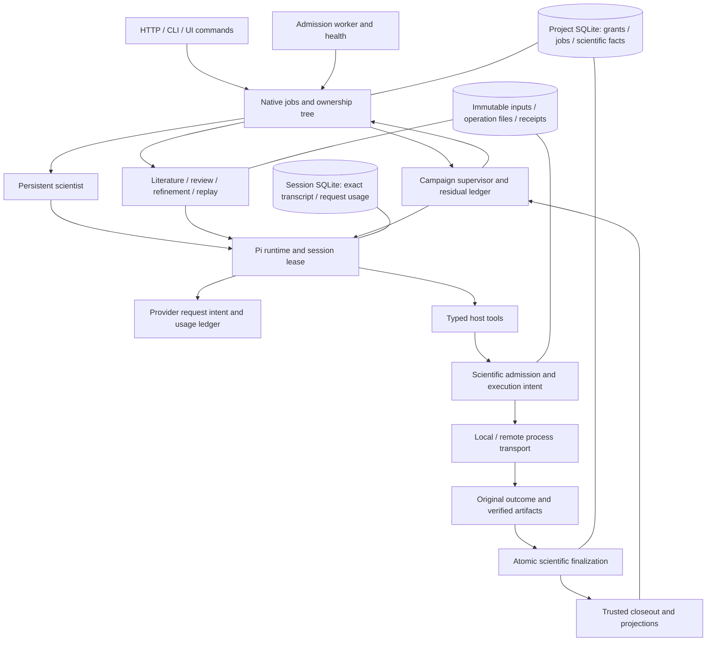

# Orchestration control plane: map, repairs and replacement design

This layer coordinates work; scientific decisions remain with the scientist and deterministic validators. The October 10 audit used three GPT-6.1 Sol agents plus root integration, against the main checkout. It covers every production orchestration lane and its persistence/ownership boundary. Live provider requests, GPU work, SSH, historical effect recovery and deployments are outside this audit. Existing historical data and grants remain unchanged.

The diagnosis is inconsistent authority and recovery contracts across components, rather than absence of durable storage. SQLite transactions, immutable input hashes, stable origin identities and receipt verification are useful foundations. The repairs below consolidate immediate authority and billing rules. A complete replacement coordinator is proposed separately; it is not already implemented.

The subsequent user-authorized implementation is now described in [the operation coordinator implementation](architecture/operation-coordinator-implementation-2026-10-10.md). The map below records the earlier audit and proposed migration; its “still requiring” and “not yet implemented” descriptions apply to that earlier stage, not the current implementation. New verification is reported separately so the old acceptance is preserved.

## Current layer map



| Component | Source ownership | Durable state and responsibility |
|---|---|---|
| Public admission and inspection | `server.ts`, `cli.ts`, `application.ts`, frontend typed client | Host-fixed project/profile; durable command identities; explicit new work, cancel, retry and reconcile are distinct |
| Native ownership tree | `science-core/research/job-service.ts`, `jobs/lease.ts` | Atomic claims; exact leaf epoch; live full ancestry; cancellation; immutable lifecycle checkpoints; detach without extending a grant |
| Worker loop | `jobs/index.ts` | Serial admission polling; known original recovery; backoff and visible degraded health; no implicit job reset |
| Campaign | `campaign/index.ts`, `campaign/policy.ts`, `campaign-resources.ts` | Saved observations/proposals, original child bindings, completed-step consumption, protected replay, residual grant/deadline |
| Scientist | `scientist/index.ts`, core scientist kernel/memory/closeout | Native program authoring, captured request identity, pending intent, scoped tools and result-driven decision support |
| Runtime/session | `runtime/index.ts`, `store.ts`, `sdk.ts`, `context.ts` | Separate short session lease, exact transcript, SDK tree, serialized journal boundaries, pending tools, compaction archives |
| Provider effects | `runtime/types.ts`, `runtime/index.ts`, `jobs/accounting.ts` | Durable request intent, known/unknown usage, completeness fence, original per-job baselines and per-lease settlement |
| Scientific admission | `science-core/research/service.ts`, `execution/index.ts` | Atomic original trial identity and reservations; active scope/current owner before new effects |
| Process transport | `execution/transport.ts`, `remote.ts`, worker remote supervisor | Exclusive launch fences, original bundle/worker identity, exact process command, terminal receipt; ambiguous launch cannot be repeated |
| Result authority | `execution/provenance.ts`, core `completeRun` | Hash/contract/seed/artifact verification, atomic idempotent finalization, conflicting receipts rejected |
| Literature | `literature/index.ts`, typed core ingest | Frozen question/context, fetched-source identity, assessment/proposal, idempotent cycle commit and publication |
| Independent review | `knowledge-review-controller/index.ts`, typed core review | Frozen dependencies/read proofs, native commit fence, review audit identity |
| Skills | `skills/controllers.ts`, `skills/service.ts`, `skills/policy.ts` | Immutable candidate; independent shadow sessions/programs/run receipts; deterministic valid-only paired activation |
| Editable workspace | `workspace.ts`, core content-addressed programs | Revision check plus unfinished-work edit fence; editable drafts are separate from immutable execution captures |
| Publication and status | core trajectory closeout, scientist events/results, knowledge exports, status APIs | Derived projections of authoritative receipts; job success, scientific outcome and accounting certainty remain distinct |

Detailed sources, state transitions, operation-specific proofs and crash windows are in the [ownership audit](architecture/orchestration-ownership-audit-2026-10-10.md), [execution audit](architecture/orchestration-effects-audit-2026-10-10.md) and [runtime audit](architecture/orchestration-runtime-audit-2026-10-10.md).

## Reproduced defects repaired

| Failure | Repair | Local evidence |
|---|---|---|
| Child heartbeat/checkpoint/success accepted after parent expiry | One snapshot `inspectOwnership` / `inspectAncestry` predicate governs claim and lifecycle commits; polling aborts on ancestor loss | Injected clock with 1s parent / 5s child; missing/cyclic/cancelled ancestry |
| New child could omit the current parent epoch | Exact `parentLeaseId` mandatory for fresh admission | Omitted/stale epoch rejected; identical original replay retained |
| Cancellation/epoch replacement raced trial creation and first launch | Managed trial admission fenced inside transaction; captured caller epoch and current grant checked at built-in local/remote launch boundary | Cancel/stale/deadline admission and preflight scope revocation tests |
| Provider dispatch only relied on delayed cancellation polling | Host authorization callback before durable intent and again immediately before provider invocation, including compaction | Ancestor revocation leaves zero provider calls, zero turns and empty intent ledger |
| Interrupted provider request appeared zero-cost settled | Durable request intent before call; valid usage settlement before tools; unknown usage prevents another request, cost settlement or residual spend | Timeout, abort, crash/reopen, missing/invalid cost, late response and failed usage fsync |
| Manifest presence could override remote timeout/cancellation | Remote terminal outcome observed before successful scientific receipt import | Valid-looking CPU artifacts plus remote timed_out yields no evaluation |
| Concurrent identical receipt finalizers falsely failed | Exact same manifest and normalized evaluation replay atomically; changed receipt conflicts | Concurrent original reconciliation commits one evaluation |
| Legacy campaign result could omit a child yet issue residual authority | Every owned child must appear in accounted steps on closeout and continuation | Unattributed child blocks continuation with no new work |
| Worker admission-store exception left healthy HTTP but dead queue | Abortable bounded backoff and worker state; health is 503 while degraded, even with unreadable store | Injected pre-claim failure, no repeated attempts/effects, health without store access |
| Interrupted/recovery-required job allowed pending draft editing | Existing unfinished-work edit fence includes these states | HTTP edit rejects changed bytes until cancellation; immutable run inputs remain untouched |

Provider ledger states are `dispatched`, `settled`, `unknown` and `not_dispatched`. A live host that proves it never invoked the provider can record `not_dispatched`, roll back the turn debit and leave provider-reported cost absent. A crash loses that process-local proof, so an unclosed dispatch intent becomes unknown. Successful explicit zero usage is known; synthesized network-error zeros are not a billing receipt. Old sessions without this field remain readable without retroactive mutation or invented certainty.

The earlier selected-child ancestry and expired-child campaign-accounting repairs remain in place. They are verified separately in [the recovered original result](acceptance/backend-recovery-reassessment-2026-10-10.md).

## Confirmed gaps still requiring architectural work

1. **Supervisor-independent worker lifetime.** A finite local reproduction killed the remote supervisor controller with a 100ms timeout. Its 600ms CPU worker completed, while its receipt stayed running. Local detached process timeout also belongs to the host controller. These paths need controller-independent supervision and adoption of proven original process identity. Saving a PID alone is insufficient; PID reuse and ambiguous launch remain real limits. No worker/host deployment change was made in this audit.
2. **Declarative recovery for every handler.** A literature/review/refinement/replay typed scientific commit can exist before `pi:job:result`. The current generic receipt-only path cannot safely recognize every such commit. Re-entering ordinary `run()` is too powerful. Each handler needs a bounded `recover()` implementation over typed original receipts, with no provider/create-session/dispatch port.
3. **Canonical operation phases instead of guard-protected mutable JSON.** Operation guard renewal aborts a stale wrapper, but a check then filesystem rename is not one transaction. Native epochs now protect managed scientific commits; standalone wrapper operations still need an atomic operation revision/epoch. Store canonical operation phase plus an outbox in project SQLite; export JSON as a projection.
4. **Cancellation and settlement are different axes.** A cancelled job can retain unknown external effects. Existing uncertain-run fencing prevents overlapping compute, but terminal job reconciliation does not necessarily settle those effects. Cancellation must revoke new-work capability while permitting separately leased observation/receipt/accounting settlement. Never infer physical shutdown or free reservations from a cancelled label.
5. **Automatic and manual recovery need one planner.** Explicit reconciliation walks root-first; ordinary worker recovery can hold at an unresolved child after expiry. Both should use the same inspection plan, with continuation an explicit separate policy. The API should return recovered root, exact effects and typed blockers rather than only an unchanged selected record.
6. **Hot ownership storage and immutable implementation closure.** Research reads currently serialize, initialize a writer transaction and load whole history; heartbeat persistence traverses records/blobs. Latency growth is an unmeasured risk. Separate indexed lease headers from append-only events and benchmark growing projects. Store/select the original trusted worker/evaluator implementation closure for receipt recovery rather than relying on the current installed evaluator. Include runtime/timeout/environment plan hashes in execution identity.

The campaign supervisor's submit_move tool still advertises Type.Any while validating a discriminated Zod move on the host. This is an additional authoring-contract gap: expose its actual supported argument schema and test the adapter payload before claiming reliable supervisory planning.

Unknown provider billing also needs an attributable evidence reconciliation interface. This pass preserves uncertainty; it cannot recover an absent upstream usage receipt. Cost limits remain stop thresholds and do not guarantee an invoice cap for an in-flight response.

## Target design

Use a deterministic host operation coordinator above the existing research store. Keep scientific policy/validators and Pi authoring separate. Independent remote and SDK leases remain useful; they must stop being alternate sources of scientific authority.

```ts
// Proposed contract; this coordinator is not yet implemented.
type OperationHandle = { projectId: string; operationId: string; jobId: string; leaseId: string }
type RecoveryOutcome<Result> =
  | { kind: 'complete'; result: Result; receiptIds: string[] }
  | { kind: 'incomplete'; boundary: string }
  | { kind: 'unresolved'; effects: string[]; accounting: string[]; blockers: string[] }
interface OperationSpec<Identity, Inspection, Result> {
  inspect(identity: Identity): Promise<Inspection> // no side effects
  recover(identity: Identity): Promise<RecoveryOutcome<Result>> // original settlement only
  run(handle: OperationHandle): Promise<Result> // separately authorized continuation/new work
}
```

An operation record has independent `owner`, `effect`, `accounting` and `outcome` fields. Its immutable grant carries original deadline, model identity, budgets, contract/source hashes and reservation. An effect carries original input hash and stable ID, with explicit prepared/launch-claimed/running/outcome-unknown/receipt-verified/settled phases. A single snapshot reducer decides whether a command may inspect, detach, prepare new work, invoke an external effect, commit a verified receipt, settle known accounting, or rebuild a projection.

New-effect authority requires current exact epoch, live ancestry, valid original grant and complete prior accounting. Receipt settlement requires proven original identity and a settlement owner, and does not extend the grant. A cancelled/expired owner cannot regain permission to infer or launch merely because its receipt arrived.

The outbox commits intent with authoritative state before an external call. It is not a claim of exactly-once network/process launch. Ambiguous acknowledgements remain unresolved until the original identity is observed. Immutable events plus typed receipts make scientific closeout/publication/result projections rebuildable without another model or worker call.

## Migration and acceptance

1. Retain current tables, immutable scientific records and historical checkpoint identities. Introduce typed operation/authority interfaces and compatibility adapters without automatic historic migration.
2. Register handler `inspect/recover/run` ports. Exercise each kill window between accepted proposal, native commit and final result for all four auxiliary lanes.
3. Persist new canonical operation phases/outbox alongside existing readers; prove equivalence with fault tests. Make JSON/SDK summary/status projections rebuildable. Do not keep two writable operation authorities after migration.
4. Introduce a durable local/remote supervisor registry and independent timeout enforcement. Test supervisor death, process adoption, ambiguous spawn, cancellation/receipt races and boot/PID identity changes with CPU workers.
5. Route unattended and explicit recovery through one typed planner, expose blockers, then optimize lease headers after measured load tests.

Every stage must prove: no stale owner creates work; no unknown cost becomes zero; an uncertain launch is never repeated; identical original receipts settle once; conflicting receipts remain rejected; expired/cancelled grants can collect results without new spend; derivative publication failure cannot replay science; all original lineage and grant boundaries remain intact.

No new GPU experiment is authorized by this design. GPU science should answer a defined comparison after local orchestration checks pass. The October 9 acceptance remains failed; its recovered result and all prior grants stay separate. Final integrated software verification is recorded in [the audit result](acceptance/orchestration-layer-audit-2026-10-10.md).
